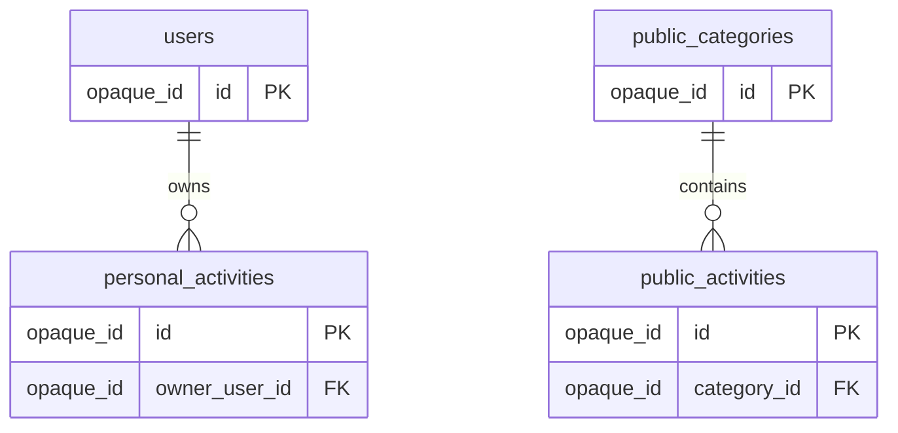

# Data model and migration contract

[Documentation index](../README.md) · [Product flows](product-and-flows.md) · [Public content and admin](content-and-admin.md) · [Migration boundaries](migration-and-decisions.md)

This is an English, implementation-oriented **conceptual specification**, not executable SQL or an approved physical schema. No database, infrastructure, application, or migration is created by this document. Existing Hebrew product requirements remain authoritative. This document records the subsequent four-table decision and distinguishes it from implementation recommendations.

## 1. Decision status and scope

| Status | Meaning |
| --- | --- |
| **Accepted** | Explicit product decision; implementation must preserve it. |
| **Proposed** | Recommended representation or mechanism with a rationale; still subject to architecture review. |
| **Observed** | Verified behavior or shape in legacy source, not a complete production data inventory. |
| **Open** | Requires a later decision or export evidence; do not silently choose a value. |

**Accepted:** four core product tables: `users`, `personal_activities`, `public_categories`, and `public_activities`. One user can own many personal activities; every personal activity has exactly one owner. One public category can contain many public activities; every public activity belongs to exactly one category. A user has exactly one durable set of group defaults, with no separate groups table or multiple-group management.

**Accepted:** personal and public activities have nearly identical content fields to make copying straightforward, but different ownership. A public save always inserts an independent personal record. There is **no source-public ID, foreign key, backlink, provenance linkage, synchronization, or deduplication against the public source**. This decision is settled, including for analytics. Personal activities have no public-category membership requirement.

**Accepted direction:** Next.js and Cloudflare. **Proposed stack:** Next.js with TypeScript on Cloudflare Workers, D1 for relational data, and R2 for category images. TypeScript, Workers deployment details/adapter, D1, R2, auth library, physical types and constraints are not fully approved. Next.js still uses React. An auth library may need auxiliary identity/session storage: four core product tables do not mean that authentication requires no technical tables.

Planning estimates supplied by the user are approximately 5,000 registered users, 50–100 daily visitors and 100–300 AI generations per day. These are rough sizing context, not measured capacity requirements, retention periods, quotas or a reason to choose arbitrary numeric limits.

## 2. Relationships and keys

The cardinalities are accepted. The English field identifiers and key representation are proposed. The diagram deliberately has no relationship between the two activity tables. Both parent tables may have zero children. Every child must resolve to its one parent, including during migration; unresolved historical records must not be published as orphan rows.

Use stable opaque identifiers; exact generation scheme is open. Titles, email addresses, category names and historical URL slugs are not primary keys. Duplicate activity titles and repeated public copies are allowed. Account deletion behavior is not specified by the accepted personal-activity deletion policy; do not introduce a user-deletion cascade by analogy.

## 3. Type and nullability conventions

The dictionaries below describe a proposed implementable shape. A field's behavioral purpose may be accepted while its name and storage representation remain proposed.

| Conceptual type | Meaning |
| --- | --- |
| Opaque ID | Stable identifier; no chosen UUID/integer/SQL encoding yet. |
| Text | Unicode string; no arbitrary maximum lengths selected here. |
| Option value | Exact legacy value, not a translated display label or invented numeric conversion. |
| Instant | Unambiguous point in time; UTC normalization recommended, physical representation open. |
| Content document | Safe representation of prose and the approved formatting; encoding still open. |
| Nonnegative revision | Proposed monotonic concurrency token, not user-visible version history. |
| Boolean | Explicit true/false; unknown historical values must not be silently treated as false. |

“Nullable” means that absence is meaningful and must be supported in the proposed representation. An empty string is not a substitute for an unknown timestamp or missing identity. Preserve original empty/missing distinctions in migration evidence before normalizing. Required-for-new fields may be unknown in historical data; rows with unresolved required values need a documented preservation/resolution path, not invented values.

## 4. `users`

**Accepted purpose:** one account record for each imported existing user or future signup. Account data is durable. Browser cache is secondary; guest defaults remain temporary. Google is the only sign-in provider; there are no password fields. The server resolves the authenticated identity to this table rather than trusting a submitted user ID.

| Proposed field | Conceptual type | Nullable? | Key / rule / status |
| --- | --- | --- | --- |
| `id` | Opaque ID | No | Primary key. Stable across sign-ins and ownership lookups. |
| `google_subject` | Text | Yes for unresolved imports; required before normal Google account resolution | Proposed verified provider identity binding. Unique when present within the accepted Google issuer. May live in library-managed identity storage instead; do not keep two competing authorities. Never equate it to Firebase UID. |
| `legacy_firebase_uid` | Text | Yes for new signups | Proposed unique-when-present migration bridge for imported accounts. Preserve this mapping either here or in a controlled migration map, with location decided before import. |
| `display_name` | Text | Yes | Observed legacy `name`; no new mandatory name collection flow. |
| `email` | Text | Yes for incomplete imports | Contact/profile attribute, not the account key or an email-only account-merging rule. Verification comes from authenticated provider evidence, not a client-supplied value. |
| `image_url` | Text | Yes | Observed legacy `image`; optional profile data, not a mandatory image feature. |
| `default_movement` | Option value | Yes until set | Accepted durable group default, represented as a field in this row. |
| `default_grade` | Option value | Yes until set | Preserve values such as `כיתה ה`; no new grade range. |
| `default_amount` | Option value | Yes until set | Preserve `1-5`, `5-10`, `10-20`, `20-30`, `30-50`, `60+`, including imperfections. Not an integer participant count. |
| `default_gender` | Option value | Yes until set | Preserve source values `חניכים`, `חניכות`, `מעורב`, distinct from labels. |
| `created_at` | Instant | Yes if historical creation time cannot be resolved | New account creation time is server-assigned. An import time must not masquerade as original signup time. |
| `updated_at` | Instant | Yes for unresolved imports | Proposed account-update timestamp. Legacy `lastUpdate` meaning requires validation before mapping. |

The four defaults form one logical set in the user row, not four groups. A signup may have no defaults yet. Before generation, all four group fields must be provided. Imported partial defaults stay recoverable; do not manufacture the missing values. Exact validation options are in [legacy fields](legacy-fields.md).

**Accepted update behavior:** prefill from account defaults; retain them until the user explicitly edits them. Generating, copying a public activity, browsing another activity or loading another tab does not replace defaults. Explicit group edits persist back to the account. The precise write boundary within the existing form submission is proposed implementation detail; it must preserve this behavior. Offline/stale browser state is not authoritative over a newer account value.

**Proposed snapshot rule:** copy the actual request values into each newly generated activity. Later changes to defaults do not rewrite prior activities or reinterpret their historical input. This preserves generation context without a groups table. Conflict handling for simultaneous default edits remains open; do not quietly add group history or multiple profiles.

Auth/session storage, account linking and session restoration will be designed with the selected auth library. Imported users without a verified Google binding remain preserved and flagged for resolution before a new signup can create a duplicate. Do not merge solely because email strings match. Admin privilege is checked server-side against the verified email allowlist on routes and mutation endpoints; no client-editable `is_admin` field is proposed. The actual admin email is deliberately absent from this repository.

## 5. Shared activity content dictionary

Both activity tables use the same proposed content field names and semantics. Required identity/ownership and lifecycle fields differ in the next sections. Separating `title` from `subject` avoids changing generation history when a user renames an activity.

| Shared field | Conceptual type | Nullable? | Rule and rationale |
| --- | --- | --- | --- |
| `title` | Text | No for new records | Display/list title; independent of generation subject. Historical missing titles need a reviewed mapping rule before enforcing this constraint on imports. |
| `body` | Content document | No for new records | Full activity prose. Failed generation creates no empty record. Public manual prose does not have to match an AI section structure. |
| `generation_type` | Option value | Yes | Legacy generated `category` maps here. It is **not** a public-library category ID. Manual public content can have no generation type. |
| `movement` | Option value | Yes | Actual generation movement when known. Recommended for new generated snapshots; often absent in legacy saved activities. |
| `grade` | Option value | Yes | Snapshot of actual input when present, not a live reference to defaults. |
| `amount` | Option value | Yes | Original input range, not inferred exact attendance. |
| `gender` | Option value | Yes | Actual generation input, not inferred from prose. |
| `subject` | Text | Yes | Original generation topic when present. Do not automatically replace it on title edit. |
| `place` | Option value | Yes | Actual location choice, including `לא משנה` when explicitly selected. |
| `duration` | Option value | Yes | Legacy `time`, e.g. `חצי שעה`; not a fabricated numeric duration. |
| `equipment` | Option value | Yes | Legacy `tools`; omitted and explicitly `לא משנה` remain distinguishable after reviewed normalization. |
| `grouping` | Option value | Yes | Legacy `contest`; preserve the grouping choice, not an invented competition flag. |
| `sabbath_adaptation` | Option value | Yes | Legacy `religion`; use the exact existing choices. |
| `notes` | Text | Yes | Legacy `info`, treated as user data, not system instructions. |

**Proposed conditional validation:** a new successful AI generation contains its actual required inputs: movement, generation type, grade, amount, gender, subject, place and duration. Optional inputs may remain null. Public manual content and imported historical records may have all or some context fields null. A copy preserves those nulls; the recipient's defaults do not fill them. This is why shared context fields are nullable instead of forcing invented group information into arbitrary public prose.

The exact content encoding (plain text plus marks, structured document, or another safe format) is open. It must support bold, underline and lists, maintain readable Hebrew/RTL and copying to WhatsApp, and disallow the unapproved color/advanced formatting UI. Imported formatting that cannot be represented must be reported and preserved in migration evidence; do not silently strip historical information. Rendering must not execute pasted/imported markup. Choice of sanitizer/editor is pending, not an added dependency here.

A new title-generation/derivation rule is still open; this document does not add another model call. Keep the accepted single generation call and do not mistake “requires a usable title” for permission to discard a low-quality result.

## 6. `personal_activities`

Include every shared content field above, plus:

| Proposed field | Conceptual type | Nullable? | Key / lifecycle rule |
| --- | --- | --- | --- |
| `id` | Opaque ID | No | Primary key, freshly assigned on every intentional public save or new generated record. |
| `owner_user_id` | Opaque ID | No | Foreign key to `users.id`. Exactly one owner, derived from the authenticated server session, immutable in ordinary edits. |
| `created_at` | Instant | No for new records; historical resolution required | Original personal creation time. For a public copy, the new copy's creation instant. Never changed by autosave/title edits. |
| `updated_at` | Instant | No for new records; historical resolution required | Proposed server time of latest accepted mutation, not the list-sort key. |
| `is_deleted` | Boolean | No | Accepted soft-delete flag. New rows start false; deletion makes them unavailable to user views immediately while preserving content for operator analysis. |
| `revision` | Nonnegative revision | No if concurrency proposal adopted | Proposed server-managed token incremented on accepted edits and deletion; protects against stale writes without storing past versions. |

There is no `category_id`, public-source reference, source URL/backlink, source hash for deduplication, or synchronization metadata. Imported personal-record identifiers may be retained in a private migration map to reconcile repeated imports; this must never be repurposed into a public-source link.

No nullable-owner guest rows. A guest's current activity and group values are temporary outside the personal database until registration. An authenticated activity is always owned. Unresolved legacy `userId` references require reconciliation rather than assignment to a placeholder user or the importing administrator.

The personal list filters to the current owner and `is_deleted = false`, newest `created_at` first. A proposed stable ID tie-breaker may resolve identical timestamps; it must not depend on edits. Each row displays only title and creation date, alongside the accepted delete action. No likes, manual order, archive, recycle bin, 30-day retention UI, restore or version-history feature is implied by these fields.

## 7. `public_categories`

| Proposed field | Conceptual type | Nullable? | Key / rule |
| --- | --- | --- | --- |
| `id` | Opaque ID | No | Primary key; names are not identifiers. |
| `name` | Text | No for new records | Category name entered by admin; historical absence needs resolution. No uniqueness policy has been approved. |
| `image_ref` | Asset reference | Yes | Optional local JPG upload; null selects the common default image. R2 is proposed, not approved. Existing `icon` references require mapping and preservation, not an assumption that they are JPG files. |

No category-order field or soft-delete field is committed by this proposal. Category ordering and hard-versus-soft storage semantics remain open. Legacy `orderId`, SEO metadata and URL-related identifiers must still be preserved through the migration strategy below. Final placement of those fields is pending; omission from this minimal product dictionary is not permission to discard them.

Admin v1 creates or deletes categories only. No edit-existing-category feature is added. Category deletion removes its public children from browsing and saving, but never touches personal copies. How this is represented physically will be decided separately.

## 8. `public_activities`

Include every shared content field, plus:

| Proposed field | Conceptual type | Nullable? | Key / lifecycle rule |
| --- | --- | --- | --- |
| `id` | Opaque ID | No | Primary key; independent of personal IDs and legacy names/slugs. |
| `category_id` | Opaque ID | No | Foreign key to `public_categories.id`; exactly one category. Not the shared `generation_type` field. |
| `created_at` | Instant | No for new publications; historical resolution required | Proposed server-assigned publication/creation time to put new entries first within their category. Never fabricate historical publication times from import time. |

No personal owner is required for public content. Admin authentication authorizes publication, not assignment of the activity to the admin's personal library. At `/admin/activity`, the admin supplies title, existing category and manually entered/pasted body, then explicitly adds/publishes. No AI generation, automatic publishing or editing of existing public records is approved in v1. Generation context may be absent throughout.

New public activities appear first in their category. Existing historical ordering must be reconciled with legacy `orderId` and possibly missing dates before selecting the final ordering representation. Popular content retains the existing behavior; `displayCount` alone is not enough evidence to invent a ranking formula. Public/category deletion storage policy and any associated fields remain open, so personal `is_deleted` semantics are not automatically applied here.

## 9. Public-to-personal copy contract

The input is an authenticated user's deliberate Save action on an available public activity. The source ID can identify the source **for the request only**; it is not persisted as a link in the personal record or as a new analytics provenance relation.

| Destination | Value for a new personal copy |
| --- | --- |
| `id` | Fresh personal ID, never source ID or a prior copy's ID. |
| `owner_user_id` | User resolved from the authenticated server session, never client-supplied ownership. |
| `title`, `body` | Value copies of the selected public content. |
| Shared generation context fields | Copy known values as values and absent values as null. Do not populate from recipient defaults or infer from prose. |
| `created_at`, `updated_at` | Server time of this personal copy's creation, not the public timestamp. |
| `is_deleted` | False. |
| `revision` | Initial server revision if the proposed concurrency mechanism is adopted. |
| Source `category_id`, source ID, legacy metadata, ranking counters | Not mapped to a personal source/category link; exclude from the personal-copy payload. |

Lifecycle:

1. Resolve the authenticated user and verify the public activity and its category are still available.
2. Read a coherent content snapshot and insert a new owned personal record. Atomicity mechanism depends on the selected database.
3. After successful persistence, navigate directly to the **new** personal detail screen in Read mode.
4. The user can explicitly enter Edit mode. Later edits only affect the copy.
5. A subsequent deliberate save of the same public activity repeats the process with another fresh ID and creation timestamp. No duplicate check against that source is permitted.

Recommended race behavior, still subject to implementation review: if category/source deletion wins before the copy's availability check and insertion are committed, copying fails without a partial row; if the copy commits first, it survives the subsequent deletion. The mechanism must not require a permanent source FK.

Transport retry protection is an open implementation detail. If used, it may distinguish retries of the same operation from new deliberate saves; it must not deduplicate by source/content or create a retained provenance relationship. Exactly-once guest-registration transfer similarly requires a later design, not nullable-owner records.

## 10. Generation, guest transfer, editing and deletion

| Operation | Required product outcome | Proposed data effect / boundary |
| --- | --- | --- |
| Successful generation, registered user | Auto-save regardless of perceived quality; open Read mode | Insert owned content and actual input snapshot only after a usable result exists. Low quality is not generation failure. |
| Failed generation | Keep filled form, brief error, retry/refresh generation action | No empty personal row; no changes to prior activities. |
| Guest generation/edit | Temporary current content, no personal library | No insert into `personal_activities`. Guest storage mechanism remains open. |
| Registration with an open guest activity | Save the current generated draft and its edits only | Resolve/create the account, then insert the current draft with non-null ownership. No historical guest-session import. Guest-origin creation-time policy needs a decision; do not trust arbitrary client timestamps as authoritative. |
| Explicit group edit | Update the one durable set of defaults | Mutate user defaults; do not rewrite old activity context. Guest defaults remain temporary. |
| Detail edit | Title/body editable only in Edit mode; Finish editing returns to Read | Update only allowed content fields and proposed mutation metadata; never owner, creation time or deletion flag from a generic payload. |
| Personal delete | Immediately hide from list/detail; retain content for operator analysis | Set `is_deleted` true. No reason prompt, inferred reason, restore UI or retention countdown. |
| Category delete | Remove category and its public activities | Storage mechanism open. No traversal into personal activities. |

**Accepted autosave behavior:** save changed data every few seconds, not every keystroke; no manual Save button. Show saving/saved/error feedback. Title changes update the list without changing its creation date or order. Guest feedback must not imply durable personal storage before registration. Finishing editing is a mode transition, not a separate manual-save requirement.

**Proposed concurrency strategy:** conditional updates verify authenticated owner, not-deleted state and the last acknowledged revision. An accepted mutation advances revision. Deletion advances revision and marks the record deleted. A delayed autosave cannot clear the deletion flag, recreate a missing row, or insert through an update-as-upsert fallback. The server rejects a stale edit rather than silently overwriting a newer one. Conflict feedback/retry interaction and in-flight save flushing on navigation remain open. This proposal does not add a restore/history feature.

The client shows “saved” only for the acknowledged content revision. Newer unsent edits remain pending even if an older request succeeds. An error must not silently discard the local draft. All personal reads, updates and deletions enforce ownership on the server, including direct detail requests and deleted-record access; a foreign key by itself is not access control.

The accepted fixed 72-hour first-visit cookie trial remains independent of these four tables. There is no sliding trial, guest user row or persistent guest personal history proposed. Expiry leaves home accessible, gates the next entry into creation/public library, does not interrupt active generation or erase open content, and login returns to the intended destination. Existing valid sessions remain valid; failed restoration requires sign-in. Public reads must respect this access gate even though their content is shared.

## 11. Legacy evidence and mapping

### Evidence boundary

Source inspected read-only on 11 October 2026: GitHub default branch `main`, pinned at [`fb950193158c2aecfb1f7eb2dc9cfcb7159e61be`](https://github.com/PoratEyal/Training-content-AI/tree/fb950193158c2aecfb1f7eb2dc9cfcb7159e61be). No live export has been supplied. Types and code are not proof that all production documents have those fields, types or relationships. The older [field-options document](legacy-fields.md) explicitly records a different local source snapshot; it is not evidence of production completeness.

| Verified source | Observed evidence and mapping consequence |
| --- | --- |
| [createNewUser.ts](https://github.com/PoratEyal/Training-content-AI/blob/fb950193158c2aecfb1f7eb2dc9cfcb7159e61be/functions/src/callableFunctions/createNewUser.ts) | Firestore user document ID is `context.auth.uid`. Keep a Firebase UID-to-new-user mapping. |
| [user types](https://github.com/PoratEyal/Training-content-AI/blob/fb950193158c2aecfb1f7eb2dc9cfcb7159e61be/functions/src/model/types/user.ts), [user utilities](https://github.com/PoratEyal/Training-content-AI/blob/fb950193158c2aecfb1f7eb2dc9cfcb7159e61be/functions/src/utils/user.ts) | DB defaults are flat `movement`, `grade`, `gender`, `amount`; API presentation groups them. Profile fields include `name`, `email`, `image`; initializer also writes `place: null` beyond the declared DB type. Types are not exhaustive. |
| [activity types](https://github.com/PoratEyal/Training-content-AI/blob/fb950193158c2aecfb1f7eb2dc9cfcb7159e61be/functions/src/model/types/activity.ts), [activity utilities](https://github.com/PoratEyal/Training-content-AI/blob/fb950193158c2aecfb1f7eb2dc9cfcb7159e61be/functions/src/utils/activity.ts) | Saved shape includes `category`, context, `activity`, `userId`, dates and counters. Input has movement, but `initActivityFromAI` omits it from output; do not claim it was saved. |
| [saveActivity.ts](https://github.com/PoratEyal/Training-content-AI/blob/fb950193158c2aecfb1f7eb2dc9cfcb7159e61be/functions/src/callableFunctions/saveActivity.ts), [getSavedActivities.ts](https://github.com/PoratEyal/Training-content-AI/blob/fb950193158c2aecfb1f7eb2dc9cfcb7159e61be/functions/src/callableFunctions/getSavedActivities.ts) | Save updates body/`savedAt` or inserts; listing filters `userId`. The new server must derive ownership from session and check the target owner, not reproduce reliance on supplied IDs. |
| [getStaticSubject.ts](https://github.com/PoratEyal/Training-content-AI/blob/fb950193158c2aecfb1f7eb2dc9cfcb7159e61be/functions/src/callableFunctions/getStaticSubject.ts) | `staticSubjects.activities` contains document-path strings resolved through `db.doc`; the API replaces them with objects. Import raw reference relationships, not an assumption that the API shape equals storage. |
| [addStaticActivity.ts](https://github.com/PoratEyal/Training-content-AI/blob/fb950193158c2aecfb1f7eb2dc9cfcb7159e61be/functions/src/callableFunctions/addStaticActivity.ts) | Despite its name, it updates existing `content` and ISO `updatedAt`. New admin create/delete-only behavior is a new requirement, not a description of this function. |
| [time.ts](https://github.com/PoratEyal/Training-content-AI/blob/fb950193158c2aecfb1f7eb2dc9cfcb7159e61be/functions/src/utils/time.ts) | Returns `YYYY-MM-DD HH:mm:ss` without offset. Language selects zone; default argument is Hebrew. See conversion policy below. |

### Mapping and preservation decisions

| Legacy data | Proposed target / treatment | Missing evidence or constraint |
| --- | --- | --- |
| Firebase Auth UID + Firestore user document ID | `users.id` plus durable migration bridge | Firebase Auth is separate from Firestore. User-supplied Auth export must establish verified Google provider subject binding. Firebase UID is not assumed to equal Google `sub`. |
| `name`, `email`, `image` | Profile attributes in `users` | Preserve raw values and resolve type anomalies; email alone never authorizes linking. |
| Flat user `movement`, `grade`, `amount`, `gender` | One set of account defaults | Do not create a groups table; do not overwrite historical activity context. |
| User `limit`, `lastUpdate`, `createDate`, `isAcceptTerms`, `isSendMsg`, initializer `place`, additional export fields | Map proven timestamps; preserve all other values in controlled migration retention | No new quota, messaging or consent UX is approved. Do not reinterpret initializer defaults as proof of recorded consent. Retention location/schema remains open. |
| Personal document ID / embedded `id` | New personal ID and private legacy-personal-ID mapping | Resolve mismatch/placeholder `ID`; avoid dropping records or accidentally merging activities. This mapping is not a public-source link. |
| `userId` | `owner_user_id` via verified user mapping | Missing/nonexistent/ambiguous owners block activation until resolved, never become null owners. |
| `activity` | `body` | Preserve full edited content. Validate rendering/conversion without losing raw originals. |
| `subject` | `subject`; title mapping separately reviewed | Legacy type has no explicit title. Do not automatically assert that subject/body-derived text was the user's original title. |
| `category` | `generation_type` | Never map this field into `public_activities.category_id`. |
| `grade`, `amount`, `gender`, `place`, `time`, `religion`, `contest`, `tools`, `info` | Shared context counterparts | Preserve unknown values for review; current dropdown validation must not silently discard historical data. |
| Missing activity `movement` | Null context unless reliable record-specific evidence exists | Do not backfill from today's mutable user defaults. |
| `createdAt`, `savedAt` | Candidate personal `created_at`, `updated_at` | Parse with proven zone/version context; `savedAt` is not the creation-sort key. |
| Personal `likes`, `fetchCount` | Preserve historical values outside active UX through migration retention | No like UI or invented analytics feature. Final retained representation is open. |
| `staticSubjects` document ID, `name`, `icon` | Category identity/name/image mapping | Preserve paths and raw image references; do not force existing icons through the new-upload JPG assumption. |
| `staticSubjects.activities` path array | Resolve public activity-to-category membership | Validate duplicates, dangling paths, multiple parents and unreferenced public records before enforcing exactly one category. |
| `staticActivities` `title`, `content` | Shared public title/body | `title` is optional in source types; reviewed fallback needed when absent. No fabricated generation context. |
| Public `name`, `metaTitle`, `metaDescription`, `displayCount`, `orderId`, category metadata/order, existing `updatedAt` | Preserve for URL/SEO/order/popularity compatibility planning and migration retention | Exact operational fields and ranking/order policy still open. Never drop because absent from the minimal dictionary. |
| Data from excluded products/languages, unknown collections/fields | Inventory and preserve in a controlled legacy archive or approved equivalent | UI exclusion does not authorize deletion. No exports or personal data belong in this public repo. |

**Proposed preservation strategy:** the owner supplies immutable raw exports and an Auth export through an appropriate private channel later. Keep raw records, original paths/IDs, field values and a transformation/disposition manifest in a controlled private migration archive. For every source record and field, record its target mapping or its preserved unresolved/retired location. Resolve active-data blockers before cutover. Archive location, access, retention and any in-row legacy payload are open; do not silently add a fifth core product table or abandon data not covered by the four tables. Never retain a public-source relationship for newly saved personal copies under the guise of a migration field.

### Date conversion policy

At the pinned GitHub commit, `getCurrentTime` uses `Asia/Jerusalem` for `he`, `Europe/Madrid` for `es`, `Asia/Riyadh` for `ar`, and `America/New_York` for other language values. Calling it without an argument defaults to `he`. The inspected local checkout differs by having additional explicit `fr` and `pt` zones. Therefore source version and provenance matter; neither implementation proves which code wrote a particular production value.

The strings carry no offset and the saved activity initializer does not retain `lang` in its returned object. Do not infer all activity dates are Jerusalem time just because the new UI is Hebrew. Validate parseability, originating language/version where available, daylight-saving ambiguity/nonexistent local times, missing values and impossible chronological relationships. Preserve raw dates and any evidence used to normalize. ISO `updatedAt` values from the public update function have different semantics and format and need a separate parsing path.

Proposed new timestamps are server-assigned instants stored unambiguously and displayed using the product's chosen locale/timezone. Unknown legacy instants remain explicitly unresolved; do not substitute the current time, epoch or import time. A nullable import staging representation/private archive may preserve them while a reviewed resolution/display/sort policy is agreed. Resolving this policy is a migration gate, not permission to make production personal creation order unstable.

### Relationship anomalies and cutover

An exported public document may be referenced by more than one category, by none, or through a dangling path; source code cannot rule this out. Produce an exception report and preserve all documents and edges. Decisions such as assigning a canonical category or creating separate public entries must be explicitly reviewed later; do not discard one relationship, invent a category or relax the accepted one-category target silently.

Similarly, map every personal owner before activation. Compare raw and imported counts by user and category, content fidelity and all preserved exception counts; count differences must have a documented explanation rather than a blanket expectation of equality after reviewed transformations. Verify that the same Google identity sees the correct history and future signups enter the same users model without duplicate accounts.

The owner handles old exports/changes, domain transition and shutdown. Keep the old system running until verification, account for changes during development, and plan final reconciliation, backup, rollback and existing content URLs/redirects. No part of this document authorizes executing those operations now.

## 12. Access patterns and validation gates

Proposed query/index needs, not SQL definitions: unique identity lookup; owner + non-deleted personal list in immutable creation order; owned personal detail lookup; category + available public entries ordered with new entries first; category membership checks during publication/deletion. Exact indexes, pagination, uniqueness semantics for nullable identities and atomicity primitives depend on the chosen database and validated data. No fixed page size, retention period or quota is selected here.

| Check | Evidence required before implementation/migration is accepted |
| --- | --- |
| Four-table contract | Diagram and implementation agree on the two one-to-many relationships; personal rows have no public-source/category FK or provenance link. |
| Owner isolation | Another user's IDs cannot read, update, delete or assign personal records, including direct routes and crafted payloads. Ownership comes from session. |
| Repeated public saves | Two deliberate saves produce distinct IDs and creation events, equal initial content, no source mutation and no retained source relationship. |
| Missing public context | Copying manually authored prose keeps context absent and leaves recipient defaults unchanged. |
| Copy independence | Editing/deleting a copy leaves the public record and other copies intact; deleting a category/public source leaves every personal copy intact. |
| Default durability | Edited group defaults survive later sessions and prefill creation; browsing/copying/generating does not unexpectedly change them. |
| Snapshot recommendation | If adopted, changing defaults leaves old activity inputs unchanged; legacy missing movement remains missing without evidence. |
| Autosave order | Title/body edits update content without changing creation time/order. “Saved” reflects the acknowledged revision, not newer unsent text. |
| Deletion race | Under the proposed concurrency strategy, a delayed autosave cannot resurrect or overwrite a deleted record. |
| Guest boundary | No personal rows exist before registration; only the current open generated draft and edits transfer afterward with non-null owner. Trial expiry preserves active work. |
| Failure boundary | Failed generation, publication or copy leaves no empty/partially owned activity; generation form data remains available for retry. |
| Admin boundary | Non-admins are redirected to `/login`; server mutations reject unauthorized users. Manual explicit publish only, no AI or edit-existing UI. |
| Identity migration | Auth export mapping proves Firebase UID-to-Google identity; repeated sign-in resolves the same imported user, without email-only merging. |
| Import fidelity | Each source record/field is mapped or explicitly preserved; raw text, edited bodies, dates, metadata and unknown fields are accounted for privately. |
| Date correctness | Known-zone cases normalize correctly, ambiguous/invalid/missing cases are reported, and no fabricated original timestamps enter ordering. |
| Public relationships | Every activated public activity has exactly one valid category; all historical multi-parent/orphan cases have a recorded resolution. |
| No scope drift | No likes, multiple groups, restore/history, source analytics linkage, extra language UI, search, or new quota feature appears through schema choices. |

## 13. Open decisions before physical implementation

1. Approve or revise the proposed TypeScript/Workers/D1/R2 stack, deployment adapter and auth library; define any technical auth/session storage.
2. Finalize field names, opaque ID strategy, physical timestamp/content encoding, indexes and constraint enforcement. The four product tables and no-source-link copy rule are already settled.
3. Choose identity-binding storage and the private migration mapping/archive format; validate actual exports and resolve identity collisions without email-only linking.
4. Agree on content/title normalization and missing-title handling without losing original prose, adding an extra model pipeline or filtering successful low-quality generations.
5. Confirm the recommended per-activity input snapshot and concurrency strategy, including stale/default edits, transport retries and navigation with pending autosave.
6. Decide public/category hard-versus-soft deletion, historical ordering and category order; verify the existing popular section rather than deriving a new policy from counters.
7. Resolve unknown historical dates/owners/category relationships, guest-transfer creation timestamp and original URL/SEO preservation before cutover.
8. Choose how retired fields and excluded products/languages remain preserved, including access and retention, without exposing private exports or reviving excluded features.

These questions are architecture and data-integrity work for the next stage, not a request to reopen the accepted product flows or independent-copy decision.
