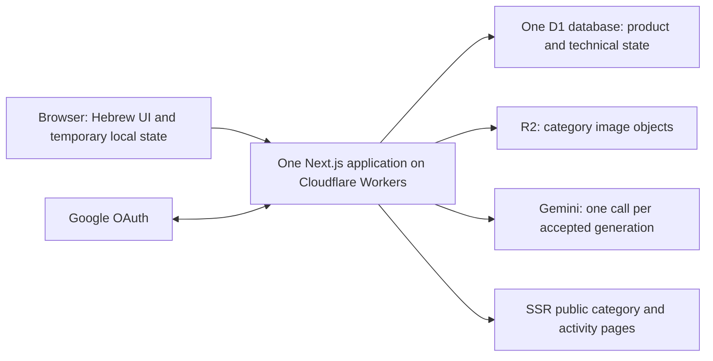
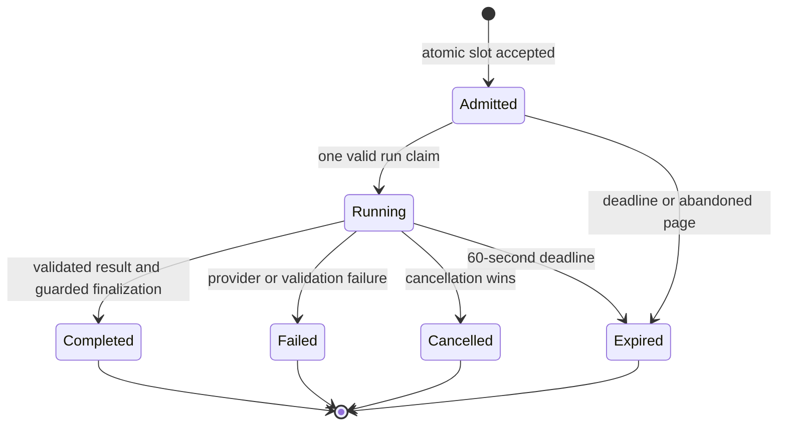

# Activity Wiz — Production architecture specification

Research checked on 12 October 2026. This specifies a production design; no application has been built, tested or deployed by writing it. Read [Product specification](product-spec.md) for exact input choices and [User flows](user-flows.md) for screen behavior. This document is self-contained about runtime responsibilities and technical guarantees. Archived proposals are not architectural authority.

## 1. Product and decision boundary

Activity Wiz is a Hebrew, RTL, mobile-first preparation tool for Israeli youth-movement counselors. A counselor generates an educational activity for their group or reads ready-made public content. Successful signed-in generation is automatically saved; public Save makes a new independent personal copy. Personal titles/text can be edited with periodic autosave. Admins publish manual content, reorder categories and delete public content. Public category/activity pages must be readable and indexable without login, including after a guest trial expires.

Group defaults—movement, participant grade, group size and gender composition—belong only to the user account. A generation request combines the current group with activity-specific values. Personal and public activities contain type, subject, place, duration, equipment, grouping/competition, Sabbath adaptation, notes, title/text and applicable ownership/lifecycle/category metadata. Neither stores a group snapshot. Copies contain all activity-specific values and text, with new identity/ownership/creation time and no source-public link or synchronization.

**Accepted decisions:** one Next.js project and codebase for frontend, server and admin; TypeScript; Cloudflare Workers, one production D1 database and R2 file storage; Auth.js/NextAuth with Google only; one production environment, no staging or branch cloud deployments. One non-streamed Gemini generation call, a 60-second accepted-attempt deadline, and at least 30 seconds between accepted generation starts per account/anonymous trial identifier. No daily or total generation quota. The guest trial starts at the first accepted valid generation attempt and lasts a fixed 72 hours. Only generation becomes login-gated after expiry; the public library stays public.

**Architecture recommendations:** the adapter/runtime baseline, database-session strategy, technical admission records, two-phase generation transport, optimistic version checks and no-shared-content-cache baseline described below. These are concrete engineering choices for review, not claims that the user selected particular package versions or SQL statements. Where a proposal adds a user-visible constraint, it is separately called out.

**Publication policy:** Documentation-only Markdown updates have standing authorization for GitHub publication through a feature branch and PR. They may merge only after required checks pass and it is verified that the merge will not deploy the application. If deployment would run or its absence is unverified, leave the published PR open. Code or mixed changes require explicit approval before GitHub publication and separate approval before merge; code merge approval includes the configured production deployment. Never direct-push main or treat documentation permission as deployment authorization.

## 2. Compatibility decision and evidence

### Runtime baseline

**Recommend actual Next.js 16 App Router through `@opennextjs/cloudflare`, using the Next.js Node runtime on Workers with `nodejs_compat`.** Use a tested compatibility date at least as recent as the adapter's documented minimum, not an unreviewed rolling date. Pin exact Next.js, React, OpenNext, Wrangler, `next-auth` and `@auth/d1-adapter` versions together when implementation begins; no exact patch combination has been tested here.

Cloudflare now recommends **vinext** for new applications and describes it as a beta reimplementation of the Next.js API surface. It is not silently substituted for the explicitly requested Next.js implementation. Cloudflare still documents manual OpenNext setup, and OpenNext's own documentation lists Next.js 16 support. This recommendation deliberately takes the documented actual-Next.js adapter route rather than claiming it is Cloudflare's current preferred new-app path. If its compatibility gate fails, stop and present the concrete incompatibility; do not switch frameworks or auth products without approval. [Cloudflare Next.js guide](https://developers.cloudflare.com/workers/framework-guides/web-apps/nextjs/), [Cloudflare OpenNext guide](https://developers.cloudflare.com/workers/framework-guides/web-apps/opennext/), [OpenNext support matrix](https://opennext.js.org/cloudflare).

| Component | Supported evidence, as checked | Project interpretation and release gate |
| --- | --- | --- |
| Next.js/OpenNext | OpenNext documents Next.js 16, App Router, SSR and route handlers. Cloudflare documents manual adapter setup. | Recommended baseline, not verified integration. Build Next.js output and the adapted Worker, then exercise it locally in `workerd`. Do not use static export. |
| Node compatibility | Adapter setup requires `nodejs_compat` and compatibility date ≥ `2024-09-23`; Workers supplies a subset of Node APIs. | Pin/test a current date and audit dependencies for unavailable native/TCP/filesystem assumptions. This is not a normal persistent Node server. [Setup](https://opennext.js.org/cloudflare/get-started). |
| Middleware/proxy | Cloudflare's OpenNext feature table still lists Node middleware unsupported, while Next.js 16 uses Node proxy. | Do not depend on proxy/middleware for this architecture. Authenticate and authorize inside server pages and mutation handlers. |
| Auth.js | Official Next.js installation documentation still uses `next-auth@beta` and documents the v5-style API. | Auth.js is accepted; the current documented integration is not evidence of a stable exact release. Pin a tested release and explicitly review prerelease risk before implementation release. Never mix v4 examples with v5 APIs. [Installation](https://authjs.dev/getting-started/installation). |
| Google + D1 | Auth.js provides a Google provider and a first-party documented D1 adapter using `D1Adapter`. | Concrete candidate combination; OAuth callback, binding resolution, sessions and adapter migrations must pass the local Worker integration gate. [Google](https://authjs.dev/getting-started/providers/google), [D1 adapter](https://authjs.dev/getting-started/adapters/d1). |
| D1 | Prepared bindings and transactional batches are documented; one database serializes its queries. | Use primary-backed atomic writes for admission, revisions and deletion. Do not authorize from stale replica reads. [D1 API](https://developers.cloudflare.com/d1/worker-api/d1-database/), [D1 concurrency](https://developers.cloudflare.com/d1/reference/faq/). |
| R2 | Workers binding exposes object operations; storage is strongly consistent, with separate cache behavior. | Private binding access, validated JPG uploads, no assumption of a D1/R2 distributed transaction. [R2 API](https://developers.cloudflare.com/r2/api/workers/workers-api-reference/), [Consistency](https://developers.cloudflare.com/r2/reference/consistency/). |

No source establishes that the complete selected version tuple, Auth.js callbacks, client-disconnect signals and application behavior already work together. That evidence must come from the prescribed build/runtime tests. Do not describe the repository as production-ready until those tests and the authorized production checks pass. Exact Gemini model remains unselected pending cost and Hebrew-quality evaluation.

## 3. One deployment, explicit module boundaries

All browser mutations are same-origin handlers in the same Next.js project. There is no separately deployed backend or API designed for other clients. Server Components read through server modules directly instead of making unnecessary HTTP calls back into the application. Client forms call route handlers; handler names below describe responsibilities, not a finalized URL contract.

| Module | Owns | Must not own |
| --- | --- | --- |
| UI and navigation | Read/Edit modes, input state, avatar/session display, pending/error feedback | Authorization, timestamps that grant access, provider keys, SQL or storage bindings |
| Authentication | Auth.js handlers, provider identity, session resolution, account creation classification | Public-content ranking, guest quota counters or email-only identity merging |
| Authorization | Owner checks, verified-email admin allowlist, same-origin mutation protection | Trusting client `userId`, avatar state or hidden controls as authority |
| Group/preferences | The account's one durable group set; temporary guest validation | Group snapshots on activities |
| Generation coordinator | Validation, admission, 30-second spacing, trial, deadline/cancellation, result finalization | Background jobs, streamed UI tokens, automatic extra model calls |
| Prompt templates/provider adapter | Fixed type-selected pedagogy, data/instruction separation, bounded non-streamed provider request | Database writes, executing user tools/URLs, deciding ownership |
| Personal activities | Independent content copies, autosave revisions, soft deletion, creation ordering | Source-public FK/provenance, mutable creation dates |
| Public catalog/admin | Public queries, numeric category positions, publication and hard deletion | Group fields or per-activity view/like counters |
| Media | Validated image upload/read/delete and object-reference checks | Client-chosen arbitrary storage keys or remote-image fetching |
| Platform/configuration | Request-scoped bindings, validated secrets, structured operational logging | Import-time production DB queries or runtime schema creation |

Resolve Cloudflare bindings in the request context through the adapter's documented binding accessor, keeping them out of browser bundles. No per-isolate memory is the authority for sessions, admission or in-flight status. A process-local flag cannot coordinate Workers in different locations or successive deployments.

## 4. D1 product and technical storage

The four core product tables represent **users, personal activities, categories and public activities**. Exact field definitions and migrations belong in planned `data-model.md`. Architectural invariants are fixed:

- One user owns many personal activities; every personal record has one non-null internal owner. Guest drafts are not ownerless personal records.
- User fields hold all durable group defaults. Neither activity table holds movement, participant grade/amount/gender, including in serialized “context” fields.
- Every public activity has exactly one public category. Its type is not its category. Public activity details match the normal personal activity-specific fields.
- A public Save inserts a fresh personal value-copy. Do not preserve public ID/category relationships, hashes used for source deduplication or hidden provenance.
- Personal deletion is soft and owner-visible immediately after it applies. Public/category deletion is hard, with public children deleted with their category. Every user-initiated Delete requires confirmation; copies are unaffected.
- Numeric category positions define both public/admin category order. Reordering never changes child ownership or within-category newest-first order.

**Recommended technical storage in the same D1:** Auth.js accounts/sessions and any required verification table; guest-trial/admission state; short-lived generation-attempt status/idempotency metadata; autosave revision metadata; operational image-cleanup references if needed. These are technical support records, not new product entities or another database. The strict admission and cancellation design needs shared durable state; four product tables are not a prohibition on that state.

The Auth.js D1 adapter documents tables named `users`, `accounts`, `sessions`, `verification_tokens`, with no configurable prefix. Recommend extending the adapter-compatible `users` row with nullable product group/default fields rather than accidentally creating a competing second user identity. Inspect the pinned adapter SQL before designing migrations. Apply reviewed schema changes as explicit release operations, **not** the adapter documentation's illustrative startup `up()` call on every Worker cold start. [Adapter schema](https://authjs.dev/getting-started/adapters/d1).

Use prepared/bound statements. Cross-row invariants use conditional statements and D1 transactional `batch`, not a select in one request followed by an unconditional write in another. A batch statement affecting zero rows is not automatically an error: later statements must remain conditional on the winning token/state, or deliberately fail a checked constraint so the whole batch rolls back. Never hold a transaction open while calling Gemini. D1's single-writer serialization makes the proposed atomic design feasible; actual SQL requires race tests. [Batch semantics](https://developers.cloudflare.com/d1/worker-api/d1-database/), [SQLite conditional UPSERT](https://www.sqlite.org/lang_upsert.html).

**Recommendation:** initially use ordinary primary D1 bindings without read replication. This avoids stale admission/ownership/deletion reads at the expected traffic. If replication is later introduced, use documented session/bookmark guarantees and primary admission writes; it is not an independent cloud environment. Do not make a security or save/delete decision using an unconstrained stale read. [D1 read consistency](https://developers.cloudflare.com/d1/best-practices/read-replication/).

## 5. Google identity, sessions and authorization

**Recommend Auth.js database sessions backed by the same D1 and `@auth/d1-adapter`.** An opaque, secure HttpOnly session cookie resolves to a revocable server-side session and internal user. This is preferable here to relying solely on a long-lived JWT because account/session validity and owner checks already need authoritative server state. Additional D1 reads are an explicit tradeoff at the stated traffic; verify latency and indexes. This is an architecture recommendation, not a previously chosen session strategy. [Auth.js session strategies](https://authjs.dev/concepts/session-strategies).

Use the official Google provider, provider subject/account identity and an internal user ID as separate concepts. Google email/profile photo are attributes, not primary account keys. Do not enable dangerous email-only account linking. Imported Firebase UID mappings will be handled in planned `migration-plan.md`; Firebase UID must not be assumed equal to Google subject. Do not allow first sign-in to create a duplicate when migration identity resolution is pending.

Resolve sessions server-side in personal pages and every mutation. Guard each target activity by authenticated internal owner and non-deleted state. Auth.js callback routes retain the library's OAuth/state/CSRF behavior; other mutations require same-origin/CSRF defenses appropriate to cookies. Validate return destinations as same-origin permitted routes, not arbitrary URLs. A route redirect alone is not mutation authorization.

Admin access requires the currently verified Google email to be a member of the parsed JSON-array allowlist from local `.env` or deployed Cloudflare secret. Validate the configuration once per request/config version as appropriate; absent, malformed or non-array/non-string entries fail closed. Canonicalize email comparison consistently without Gmail dot/plus rewriting; the reviewed configuration must use the same policy. Persist trustworthy verification evidence from the provider—not a client boolean—so later session-based mutations can enforce verified status. A removed allowlist member must lose access on the next checked request rather than through a stale cached role. Unauthorized admin pages redirect `/login`; mutation responses reject safely without performing the write. [Google verification property](https://authjs.dev/getting-started/providers/google).

A recognized invalid registered session blocks generation and personal/admin continuation until login, but **never makes public reading private**. Do not silently issue a guest identity as recovery from failed session restoration. Anonymous browsers without recognizable account evidence cannot be universally identified after clearing cookies; document that limitation honestly.

On new registration, transfer only the current guest draft's activity-specific details/text/title, idempotently, after creating/resolving ownership. On existing-account login, discard that guest draft and use account defaults. Failed login does not discard it. Unsaved edits to an existing personal record are not guest drafts and may only be submitted under their original owner. A short-lived signed registration-result marker is recommended to distinguish first registration from ordinary login without trusting the browser's claim that the account is new.

## 6. Guest trial and strict generation admission

### Identity and timing

**Accepted:** 72 hours starts at the first accepted valid generation attempt; failures consume time, later attempts never reset it. Public pages are readable before/during/after the trial. Signed-in users and guests have no daily/total generation quotas. Accepted generation starts for a given account or trial identifier must be at least 30 seconds apart, including retries after failure.

**Recommend:** establish an unguessable signed opaque anonymous cookie before admission, with HttpOnly, Secure in production and an appropriate same-site policy. Keep authoritative trial start and next-eligible time server-side in D1. The cookie identifies state; a client timestamp never grants eligibility. Creating an identifier while opening a form does not start the trial. If cookies cannot be retained, explain that guest generation needs a valid trial identifier instead of silently issuing a new trial on every click. Cookie removal is an acknowledged abuse limitation, not something an IP-wide limit can accurately solve.

### Atomic admission algorithm — proposed mechanism

Use a unique principal key that is either the authenticated internal user or the anonymous trial ID. Use D1-evaluated time for atomic comparisons, not client time and not conflicting Worker-local clocks. Keep the admission statement short.

1. Check request origin, session classification, allowed options and all free text before trying admission. Recommended: validation, auth and rate-limit rejections do not consume an accepted slot or start a trial.
2. Atomically initialize/update the principal's admission state only if a guest has not expired and its next-eligible time has passed. In the same transaction, initialize the guest's first-start once if needed, advance next-eligible by 30 seconds from the accepted start, and create the uniquely identified pending attempt with a 60-second deadline.
3. Only the winning admission token may run that attempt. Same-operation retries reuse its token/status and do not create a second provider call. A later deliberate generation is a new attempt subject to the same principal gate.
4. Rejections return a structured reason and remaining wait derived from authoritative state. On an accepted attempt's failure at 12 seconds, for example, only 18 seconds remain—not a fresh 30 seconds from the failure.
5. D1 unavailability fails admission closed. Do not fall back to in-memory or browser counters. Failure after admission, including before reaching Gemini, keeps its consumed interval.

Conditional insert/upsert and transactional predicates must be demonstrated under concurrent requests from separate simulated Workers. The Workers Rate Limiting binding is **not** the strict gate: Cloudflare documents per-location scope and eventually consistent permissive counters. It can only be optional supplementary abuse protection, not evidence of globally exact spacing. [Rate-limiter limitations](https://developers.cloudflare.com/workers/runtime-apis/bindings/rate-limit/).

**User-visible proposal requiring review:** allow at most one in-flight generation per principal even once 30 seconds have elapsed, until completion/cancellation/deadline. This avoids overlapping work across tabs; it is not an accepted daily quota. If rejected, the implementation must allow multiple distinct in-flight attempts after each 30-second interval and track them independently. Never overwrite the first attempt's cancellation state with the second. Other endpoint rate limits need a separate justified policy; no arbitrary per-day caps are introduced here.

## 7. Generation request lifecycle, deadline and cancellation

### Transport and state — recommended design

Use a same-page **admit then run** transport to expose the authoritative accepted time/deadline without streaming activity text:

1. The page submits validated activity inputs for admission. A successful response returns a signed/unguessable attempt ticket, accepted time and deadline. The clock starts here; waiting between admission and run consumes the same 60 seconds and 30-second interval.
2. The same still-open page immediately runs the ticket. A single-use conditional claim prevents duplicate run requests. The handler revalidates the supplied inputs and verifies a keyed digest binding the admitted activity payload to the ticket. Read the current signed-in group from the account, or validate guest group input. No raw prompt/group snapshot is persisted in the attempt ledger.
3. The Worker awaits one bounded Gemini request and buffers its complete response. The UI remains Loading, then displays a fully validated completed activity—never incremental AI text. `generateContent` is the non-streamed provider path; SDK automatic retries must be disabled or audited so one attempt does not silently make several model calls. [Gemini generation API](https://ai.google.dev/gemini-api/docs/text-generation).
4. Finalize before deadline only if the attempt is still active and uncancelled. Authenticated success inserts exactly one owned activity and marks the attempt complete atomically. Guest success records only terminal technical status; return the content to the current page, without persistent guest activity storage.
5. Timeout/failure/cancellation becomes terminal. A new deliberate Retry is a new admitted attempt; an execution ticket is never a resumable background job.

The ticket/ledger contains principal, operation identity, accepted time, deadline, state, payload digest and—only for a successful registered attempt—the resulting personal ID. It is not a public-source link, prompt archive or per-activity group snapshot. Exact columns, cleanup retention and SQL belong in planned `data-model.md`. Keep sufficient terminal idempotency metadata to prevent a delayed replay creating a duplicate; expiry must never reauthorize an old ticket.

### Deadline enforcement

The 60 seconds covers execution and finalization after admission, not just provider wait. Use a server timer/AbortController for prompt cancellation of the fetch and a **D1 deadline predicate at the actual finalization decision** so a delayed timer or slow provider cannot insert a late activity. Reserve time within that envelope for result validation and persistence; do not begin a new provider call or restart the clock on retry of the same operation.

Proposed finalization uses a transaction whose insertion is conditional on matching active ticket/principal, no cancellation and current D1 time before deadline; terminal status/result identity is committed with it. A unique operation key prevents duplicate insertion. A zero-row condition must cause no later unconditional insert/update. Timeout/cancel transitions compete against that same state on D1. Check the local abort signal immediately before dispatching finalization as well. Once a cancellation/expiry decision wins authoritatively, no subsequent result can be saved.

An instant before the database's finalization decision and an instant when the browser receives acknowledgement are not the same. A commit validly decided before the deadline can be acknowledged after it due to network delay. Do not report an unconfirmed transport timeout as proof that nothing was saved, or delete an already completed valid activity. Reconcile the operation status for the same owner; a completed record is normal saved content, not resumed generation. Tests must distinguish late provider result rejection from timely commit/late delivery.

### Leaving the page and disconnect limitations

**Accepted:** the user must keep the generation page/tab open. Leaving/closing abandons the request; there is no queue, cron, resumable task or promise that reopening continues generation. Merely switching tabs while the page remains alive need not cancel, but browser suspension/network loss can still prevent completion within 60 seconds.

On deliberate navigation/close, abort the browser request and best-effort send a cancellation notification tied to the principal/ticket. The server marks cancellation conditionally and aborts its outbound fetch when notified or when an incoming request signal indicates disconnect. Workers documents incoming `request.signal` behavior via `enable_request_signal`; verify that the selected compatibility date enables it and that OpenNext passes the original signal through. If it does not, add/test a narrowly scoped adapter boundary within the same Worker or treat cancellation integration as a release blocker—do not falsely infer disconnect from a client timer. [Workers Request signal](https://developers.cloudflare.com/workers/runtime-apis/request/).

Abort is best effort toward Gemini: it can stop waiting/transport without guaranteeing the provider stopped processing or billing. Unload delivery is unreliable. If the server completed before learning of the disconnect, the already committed personal activity may exist. If a cancellation marker wins before finalization, no activity is inserted. A complete guest response lost on disconnect is not recoverable through a guest history. Document these races in UI/help without promising perfect tab-close detection.

Keep generation inside the awaited HTTP execution; do not put provider calls or personal finalization into `waitUntil`, `next/after` or a background queue. Cloudflare's HTTP wall time can continue while a client remains connected; CPU limits are separate, and post-disconnect `waitUntil` is only bounded extra lifetime. The application's 60 seconds is its own enforced deadline, not a Workers platform timeout. Bounded cleanup/logging may use a permitted lifecycle facility, but never to continue an abandoned generation. [Workers limits](https://developers.cloudflare.com/workers/platform/limits/), [Execution context](https://developers.cloudflare.com/workers/runtime-apis/context/).

## 8. Validation, prompts and content safety

**Accepted input policy:** all free-text destined for AI is validated server-side, plain text only, no links; a manually maintained blacklist exists and is initially **empty**. Allowlisted movement/type/options must match the exact product choices, including the amount-range imperfections. Reject invalid input before admission where possible and preserve the user's form with useful feedback. Never invent forbidden terms or use a second model moderation pipeline.

**Recommended validation pipeline:** verify shape and bounded encoded request size; normalize a comparison copy using Unicode normalization and case folding where relevant; trim required text; reject control/markup constructs that violate plain text; apply link detection and the blacklist; pass only named allowed fields to prompt construction. Preserve readable original Hebrew where normalization is only for comparison. Guest input and account-stored group values are still validated when used.

Link rejection should cover explicit schemes (`https:`, `http:`, protocol-relative links), `www` forms, bare host/domain forms, IP-address URLs and obvious spaced/encoded obfuscations after bounded normalization/decoding. Use a maintained parser/domain-token policy plus tests, not a claim that one regex finds all links. Do not fetch candidate URLs to classify them. Define punctuation boundaries to avoid treating every decimal or Hebrew abbreviation as a domain. Unavoidably ambiguous prose/domain-like text may be rejected with a message to describe it without a link; include Hebrew/Latin/IDN, punctuation, zero-width and encoded examples in tests. Exhaustive obfuscation detection is not promised.

**Proposed bounds for review, not approved quotas:** subject up to 300 Unicode code points and additional notes up to 2,000, with a separately bounded byte size for the whole request. These keep the free-text portion small relative to the pedagogical template. Exact body/title and output-size limits must be set from realistic activities and model context/cost tests in `api-contracts.md` and `ai-generation.md`. Do not use DB truncation as validation or quietly cut user text. Admin title/body are manually authored content, not AI input; their editor formatting is validated/sanitized under a separate bounded content policy.

**Blacklist recommendation:** match normalized complete tokens or explicit multi-token phrases, not arbitrary substrings, to avoid accidental matches inside Hebrew words. Keep normalization/matching rules versioned and testable. The empty initial list means no blacklist rejection today; owner-maintained future entries are configuration content, not guessed policy.

Prompt injection resistance is layered: fixed trusted template/shared guidance, separately labeled untrusted text, exact allowlisted type selection, no tools, no code execution, no external retrieval and a fixed server-controlled provider destination. Validate complete output shape, nonempty text/title and safe formatting before saving. Render through an allowlisted text/document representation supporting bold/underline/lists; never execute model HTML or fetch model-supplied links. This reduces exposure; it does not guarantee detecting every instruction embedded in user text or every bad model answer. A technically valid poor-quality activity is still saved for registered users to edit/delete.

## 9. Autosave, copying and mutations

**Accepted autosave contract:** periodically send changed title/body every few seconds. No manual Save, save-on-exit flush or navigation blocking. Leaving/closing personal detail discards locally unsent personal edits. The temporary guest draft is a separate P11/F02 authentication handoff: preserve it through intentional Google login until new-account transfer or existing-account disposal is resolved; this is not a personal-autosave flush. A tab switch while the same page remains retained keeps the local draft. Already-sent requests may finish after navigation; returning shows persisted server content. Finish editing changes mode and does not force a hidden flush.

**Recommend serialized/versioned saves:** maintain one in-flight save per open detail, with newer local edits queued only while that detail remains open. Send the last acknowledged revision; the server conditionally updates by internal owner, non-deleted state and revision, then advances revision. Preserve creation timestamp and order. A stale conflict does not overwrite new saved content; show an error while the page remains open. Leaving still discards unsent local edits rather than creating a recovery/history feature. A soft-delete advances/fences revision so a delayed update cannot resurrect or upsert the record. No client payload can clear deletion or transfer ownership.

Show “saved” only for the acknowledged local revision; saving an earlier snapshot while newer edits exist leaves them pending. Errors remain visible without inventing save completion. Session failure rejects the save; if the user stays on the retained detail, local text may remain for reauthentication under the same owner. If they leave/close that page, the unsent text is discarded under the accepted exit rule. No background retry after exit.

Public-copy writes take a coherent public activity read and perform a new owner-bound insertion; require the source/category to still exist at the transaction decision. Every deliberate Save gets a new operation identity and new copy, even of identical text. Idempotency may prevent transport replay of **that** operation, never deduplicate by public source, retain source provenance or turn it into a synchronization relation.

All deletion controls display the simple popup; Cancel performs no mutation. Public/category hard-deletion and category reorder use atomic D1 batches, with positions maintained as a consistent sequence. Handle reorder conflicts via a catalog revision proposal, not silent last-client overwrites of deleted categories. R2 cleanup after category removal is a separate storage concern and cannot undo the database deletion. UI state covers pending, validation, failed and completed states for login, generation, autosave, copy, upload, publication, deletion and reorder.

## 10. Public rendering, SEO and cache policy

SEO is a first-class requirement: category and public activity text must be in server-rendered HTML with meaningful title/description, canonical URL, stable internal links and indexable responses. The same public text is served regardless of crawler identity, login or trial cookie. Use Next.js metadata and sitemap/robots conventions; exclude personal/generation/auth/admin URLs from sitemap and mark them noindex. Noindex/robots never replace authorization. [Next metadata](https://nextjs.org/docs/app/getting-started/metadata-and-og-images), [Sitemap](https://nextjs.org/docs/app/api-reference/file-conventions/metadata/sitemap).

**Recommend baseline: dynamic public SSR with no shared HTML/data cache for mutable catalog content.** Query current D1 catalog state per request, explicitly disable full-route/data caching and CDN HTML caching for these routes, and do not enable ISR merely because an adapter template offers it. At this traffic, correctness after hard deletion/reorder is worth measuring before adding invalidation infrastructure. Public SSR does not imply static export. Stable hashed application assets may be cached independently.

This baseline makes invalidation concrete: after a committed create/delete/reorder, newly loaded lists, details and the dynamically generated sitemap read current state; the admin refreshes affected client queries/router state after acknowledgement. Already-open public pages can be stale until refresh, but a Save always rechecks availability. On missing/deleted public URLs, preserve the product's Home redirect behavior using a non-permanent redirect and remove the URL from sitemap; do not make a redirect response cache a deleted body. Revisit 404/410 policy with product approval if SEO evaluation warrants it; do not silently change the agreed redirect.

Render a neutral navigation shell with public HTML, then resolve avatar/Personal/Save availability via an uncached same-origin session request on the client. This keeps public content crawler-readable without serializing private account/session data into shared responses. Alternatively fully personalized SSR must remain private/no-store; the chosen shell approach avoids unnecessary session dependence on catalog reads. Session/auth endpoints and all personalized HTML/data use private no-store, never cache cookies/tokens or another user's avatar into public responses. Do not allow auth/session failure to break anonymous public content rendering.

If a later version adds catalog caching, it requires a reviewed invalidation design covering category order/index, activity detail/category list, sitemap and deleted image references with cross-location behavior. A local Cache API deletion is not assumed to purge all locations. Until that exists, no shared cache stores mutable catalog documents.

## 11. R2 images and consistency across stores

Use the Worker R2 binding for validated optional category JPG uploads. Browser code never receives write credentials. Recommend upload through the authenticated admin handler with a bounded body rather than direct public uploads at this scale. Verify actual file signature and decodable JPEG content, MIME/extension consistency, dimensions and resource budget; size/pixel limits need measured values before implementation. Filename is not a storage key or proof of type. Reject invalid uploads preserving the category name. Default image is a shared application asset, not a fabricated R2 object per category.

Recommend unique opaque object keys and category references in D1. Upload then create the referencing category; on D1 failure, attempt cleanup and retain minimal cleanup metadata if cleanup fails. Database and R2 writes are not a single transaction. Hard-deleting a category removes catalog rows first and makes media references unavailable; delete the no-longer-referenced object separately without ever deleting the shared default. Cleanup recovery is an explicit operator procedure in planned `operations.md`, not permission to run a background generation queue or provision another service.

Serve images through a controlled public Worker route that verifies the category/object reference. Baseline mutable/category-image responses are no-store to avoid serving deleted files through a stale CDN cache; static shared art can be immutable. R2's consistency does not purge an already cached response. Do not add Cloudflare Images as an unapproved service or rely on adapter image optimization that requires it; use validated appropriately sized assets until a separate optimization decision is made. [R2 consistency and caching](https://developers.cloudflare.com/r2/reference/consistency/).

## 12. Configuration and operational visibility

Names below are a **proposed inventory**, except the documented Auth.js names; placeholder descriptions are not secrets. Runtime bindings and runtime secrets must be available to the built Worker, not merely to the build process. Server-only settings must never use a public-client prefix or enter generated client code.

| Configuration | Kind / scope | Purpose |
| --- | --- | --- |
| `DB` | D1 binding | The single production database; local/CI binds only local fixtures. |
| `CATEGORY_IMAGES` | R2 binding | Approved production image storage; local/CI fixture binding otherwise. |
| `AUTH_SECRET` | Runtime secret | Auth.js cryptographic secret; stable across versions until planned rotation. |
| Google client ID / secret | Provider runtime configuration | Auth.js Google OAuth, fixed trusted callback/origin; exact env names follow the pinned provider version. |
| `ADMIN_EMAILS_JSON` | Local `.env` string / production Cloudflare secret | Valid JSON array, for example `["admin-one@example.com","admin-two@example.com"]`; missing/invalid fails closed. |
| `GEMINI_API_KEY`, `GEMINI_MODEL` | Secret + reviewed model config | Fixed provider credentials/model; never accepted from a browser payload. |
| `TRIAL_COOKIE_SECRET` | Runtime secret | Sign/verify opaque anonymous identifier; independent rotation plan from auth. |
| Public site origin and support destination | Validated non-secret config | Canonicals, allowed return URLs and Contact support. |
| Advertising/Clarity settings | Approved integration config | Supplied identifiers and exact placement map; no invented values in docs. |
| Validation/blacklist config | Server-owned policy | Empty blacklist initially; proposed input budgets reviewed before release. |

Wrangler and Next.js have distinct local environment-loading conventions. The accepted local allowlist source is `.env`; the implementation must explicitly verify its propagation into the OpenNext local Worker runtime instead of assuming Next dev and local `workerd` load identical files. Do not silently switch the local source to a committed secret file. CI uses synthetic values. [Cloudflare secret loading](https://developers.cloudflare.com/workers/configuration/secrets/).

Reserve actual advertisement slot dimensions to reduce layout shift, preserve provider/placements/formats and defer nonessential script work without preventing required ad behavior. Clarity activation accompanies the production-domain transition, not an additional analytics product. Recommend masking/excluding personal activity/editor/free-input content from recording and verifying that provider configuration does not expose private text. About/FAQ/Contact/Privacy keep supplied text but receive the new visual design. Exact ad/content packages remain release inputs.

Use Cloudflare operational logs/metrics for error diagnosis rather than inventing per-activity popularity counters. Log correlation ID, code version, operation class, status, latency, timeout/cancel outcomes and sanitized error codes. Do not log full prompts, generated personal text, cookies/tokens, secrets or complete emails. D1/Worker failure rates and approximate provider usage inform operator decisions; do not present aborts as guaranteed cost savings. Observability retention/sampling is specified in planned `operations.md`. User-visible errors remain short, preserve applicable form state and offer generation Retry/Contact support without leaking provider/internal errors.

## 13. Single-production development, CI and release

One codebase deploys one production Worker application with one production D1 and R2 storage. **No staging, branch deployments, preview cloud environments or separate test cloud databases.** Local development and ephemeral CI `workerd`/D1/R2 fixtures are process-local test resources, not another deployed environment and never production bindings. Auth/provider network behavior can be mocked locally; true OAuth and production integration checks have residual coverage limits without a staging environment. State that risk rather than claiming mocks prove live callback configuration.

Use feature branches, one PR per branch, mandatory type checks, Next/OpenNext production build and relevant tests before merge. Once explicitly approved for implementation, prefer one controlled CI pipeline with production credentials only in the main-deployment job; PR jobs have none. Disable automatic preview/version-URL deployments and third-party integrations that publish branch builds. Cloudflare supports branch build configuration, so verify it rather than relying on defaults. [Build branch configuration](https://developers.cloudflare.com/workers/ci-cd/builds/build-branches/).

Publication and release sequence:

1. Prepare a feature branch and reviewable changes; use one PR per branch and never direct-push main.
2. For Markdown-only documentation, standing authorization covers GitHub updates, push and PR creation. Validate links, consistency and the exact changed-file scope; preserve all configured required checks. Application typecheck/build/tests remain mandatory when application code exists and applicable checks require them; do not claim they ran in a documentation-only repository.
3. For code or mixed changes, obtain explicit approval before publication. After required checks pass, present the exact PR/commit for separate merge approval.
4. Documentation-only merge is authorized only when checks pass and it is verified not to trigger application deployment. Otherwise leave the published PR open; do not alter deployment configuration to bypass this boundary.
5. Approved code merge to main triggers the single automatic production deploy. Make that consequence explicit, verify deployment and authorized smoke checks, and report failures. Documentation publication never authorizes production deployment, migrations or rollback.

Future D1 schema changes must be backward compatible with the currently deployed code and evaluated on ephemeral fixtures. Do not run migrations as PR checks, on build import or during request startup. Release ordering/backups and any separately authorized production migration must be explicit before approving a merge that needs it. Code rollback does not undo schema/data writes. Never reset the one production database to make a test pass.

## 14. Required implementation evidence

These are focused correctness gates, not a claim they have already passed:

| Gate | Evidence required |
| --- | --- |
| Version/runtime | Pinned dependency tuple; typecheck, Next build and OpenNext build; local `workerd` SSR, bindings, Auth.js handlers and no unsupported proxy dependency. |
| OAuth/session | Google/provider identity mapping fixtures, cookie/return-origin behavior, database sessions, verified-email allowlist and revoked/invalid session rejection; authorized live callback check before normal use. |
| Strict admission | Concurrent requests from multiple simulated instances admit only eligible starts; exactly 30-second boundary, failed attempt remainder, trial first-start once, expired guest denial and public read unaffected. |
| Idempotency | Same run token never produces two calls/inserts; separate intentional public saves always create distinct copies; retained terminal states do not revive after cleanup. |
| Deadline/cancellation | Provider result after 60 seconds rejected; cancellation wins before finalization; finalization wins before disconnect; lost response after committed success; never continue generation with `waitUntil`. |
| Editor races | No flush/block on exit, unsent discard, tab-switch retained draft, sent write allowed to finish, stale revision rejection and deletion fence. |
| Ownership/data shape | Owner isolation on every operation, no persisted group snapshot, complete public metadata copy and independent hard-delete survival. |
| Validation | Plain-text/link variants, Hebrew normalization, empty blacklist, option allowlists, budget boundaries, injection attempts and safe output rendering. |
| Public/SEO/cache | Raw HTML contains catalog text/metadata, public access with expired/invalid cookies, sitemap/canonical consistency, no session/avatar leakage, immediate new-read visibility after mutation. |
| Media/admin | Byte-valid JPG limits, failed upload/create cleanup, allowlist fail closed, category reorder concurrency and confirmed cascade deletion without personal loss. |
| Release controls | PR checks cannot access production secrets/data, no cloud preview provisioning, only authorized merge/main triggers production deployment. |

Cloudflare documents an in-Worker Vitest integration with local bindings, suitable for the runtime part of these tests; use it or an equally evidenced local harness, not just Node-only mocks. Build tests should stub Google/Gemini and use synthetic data, never spend production model quota or mutate D1. [Workers testing](https://developers.cloudflare.com/workers/testing/vitest-integration/).

## 15. Remaining decisions and planned document ownership

- **Compatibility lock:** pin and test the actual Next.js/OpenNext/Auth.js tuple; the official Auth.js beta channel and OpenNext middleware limitation are real release concerns. If verification fails, present the concrete failure without substituting vinext/Auth0.
- **Reviewable recommendations:** D1 database sessions, two-phase generation transport and technical state representation; the proposed one-in-flight-per-principal restriction needs product review. The 30-second minimum itself is fixed.
- **Budgets and policies:** exact field/output/upload bounds, session lifetime, technical ledger retention and optional endpoint abuse limits require measured values; none creates a daily/total generation quota.
- **Content/runtime assets:** model version, templates, admin type-label presentation, ad-slot inventory, support destination and final informational text/design remain to be finalized.

Planned, not yet created: `data-model.md` owns physical product/auth/technical schema and atomic-query invariants; `api-contracts.md` owns request tickets, errors and revision/cancellation/retry contracts; `ai-generation.md` owns templates/model evaluation; `design-system.md` owns UI states and assets; `operations.md` owns configuration, cleanup, backups and release/rollback procedures; `migration-plan.md` owns user-provided export mapping and verified Google identity continuity; `implementation-plan.md` sequences these build gates. These are filenames, not broken links or permission to create resources now.

Documentation publication follows the standing Markdown-only authorization above. Implementation, infrastructure and production actions retain their separate approval requirements.
