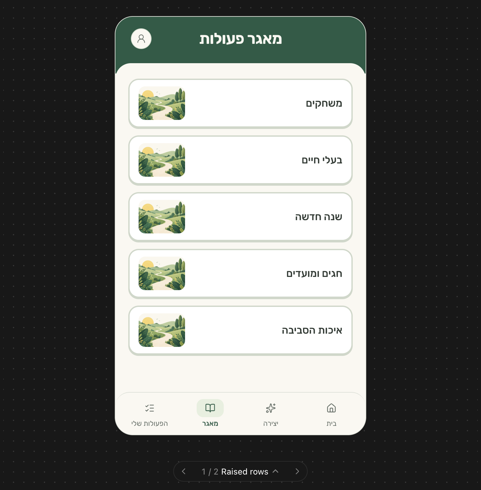

# Library page redesign — Raised rows

Implementation handoff, 20 October 2026.

## Request for the implementing AI

Implement the **Raised rows** design for ActivityWiz's `/library` category page, using the reference screenshot and specifications below. This is a visual redesign of the category index, not a change to the library's data or navigation flow.

The user selected this compact row design after rejecting square cards and earlier mockups with oversized type and detailed, shaded illustrations. Match the established application's scale and visual identity.

**This document supersedes the two-column category-grid requirement in `docs/design.md` and `docs/screens.md` for `/library`.** Keep all unrelated product requirements. The group-page header alternatives discussed separately are not part of this task. Do not apply them or redesign other routes.

Read `AGENTS.md`, the relevant guides under `node_modules/next/dist/docs/`, and the existing implementation before writing code.

## Visual reference

The screenshot shows the selected library design. Its dark dotted background, preview frame, and “1 / 2 Raised rows” carousel controls belong to the design preview, not the application.

The screenshot is enlarged. **Use the CSS-pixel dimensions below; do not measure the enlarged screenshot and turn those measurements directly into CSS.** The original preview represented a 390px-wide mobile screen.

## Scope and hierarchy

The screen has three parts:

1. A compact forest-green masthead with the centered title **מאגר פעולות** and the account avatar on the left.
2. An ivory content area with rounded top corners, containing one vertical list of full-width category rows.
3. The existing bottom navigation, with **מאגר** active.

Use only one visible page title. Remove the existing duplicate body heading **מאגר פעולות מוכנות**.

Each category row contains exactly:

- Its category name, vertically centered and right-aligned.
- A small rounded illustration thumbnail on the left.

**Do not display activity counts**, including zero counts. Do not add subtitles, badges, chevrons, popularity rankings, search, filters, or extra calls to action.

## Palette and typography

Use the existing Rubik font and rounded Lucide functional icons. Keep Hebrew RTL.

| Token | Value | Use |
| --- | --- | --- |
| Forest | `#255B46` | Masthead, active navigation |
| Ivory | `#FAF8F1` | Page, navigation, header title |
| White | `#FFFFFF` | Category rows |
| Main text | `#303A34` | Category names |
| Muted text | `#626D65` | Inactive navigation and avatar icon |
| Sage | `#E7EFDF` | Active navigation pill |
| Row border / lower edge | `#CED7C9` | Tactile row outline |
| Divider | `#DDE1D8` | Navigation divider |

| Element | Size / weight / line height |
| --- | --- |
| Page title | `24px / 700 / 32px` |
| Category name | `16px / 500 / 24px` |
| Navigation label | `11px / 400 / approximately 1.3`; active weight `500` |

Do not use marketing-headline typography for category names. Avoid blanket bold styling. Preserve text enlargement and allow the interface to grow instead of clipping.

## Masthead

- Forest background, approximately **88px total height** at the reference size.
- Title centered across the screen, not merely centered between uneven content.
- Top padding **18px**, horizontal padding **16px**.
- Use balanced **40px side regions**, with an empty region on the right and the avatar on the left.
- No back arrow on this library tab root, matching the selected screenshot. Keep parent-navigation arrows on nested category/activity routes.
- Avatar is approximately **32 × 32px**, with an ivory surface, subtle border, and a **20px** icon for guests.
- Preserve the real account avatar, account-menu interactions, and sign-in behavior.
- No large heading illustration or additional hero region.
- Keep the header sticky within the existing app scrolling model. Ensure the ivory seam remains visually attached to the header when content scrolls; rows must not show through behind it.

## Ivory content area

- Ivory surface with **24px top corner radii**.
- Overlap the masthead by **16px**. This means the ivory surface starts approximately 72px below the screen's top.
- Content padding: **24px top**, **20px horizontally**, and at least **24px bottom**, plus whatever clearance the fixed navigation requires.
- At narrow phone widths, horizontal padding can reduce to **16px**. The reference spacing at 390px is 20px.
- Use a single-column list with **12px gaps**.
- Do not stretch rows to fill the viewport. With a short list, natural ivory space below it is correct.
- No advertisements or reserved advertisement gaps, including the old full-width spacer inserted after the fourth category.

## Category rows

| Property | Specification |
| --- | --- |
| Width | Full available content width |
| Minimum height | **76px** |
| Background | White |
| Border | **2px solid `#CED7C9`** |
| Corner radius | **16px** |
| Lower edge | **`0 2px 0 #CED7C9`** |
| Padding | **10px vertically, 14px horizontally** |
| Layout | Horizontal flex, vertically centered, name right / thumbnail left |
| Gap between name and image | At least **16px** |
| Name | Rubik 16px/500, dark text, right-aligned |
| Thumbnail | **72 × 52px**, **10px** radius, cover crop centered |

Use border-box sizing. The 76px minimum height includes padding and borders. Let long names wrap and the row grow; do not truncate meaningful names or shrink their type. Keep the thumbnail from shrinking.

The entire row is a real link to that category, with a generous tap target. Do not add a second nested interactive target around the thumbnail.

On press, move the row down **2px** and remove its lower shadow. Use approximately 100ms feedback, with reduced-motion support. A restrained sage tint or forest border on hover is acceptable; avoid scaling, bouncing, or large shadows.

Keep a clearly visible keyboard focus ring. Do not rely solely on color to communicate focus.

## Illustration strategy

### Initial implementation: match the selected screenshot

Use **`public/illustrations/home-trail.webp` as the shared temporary thumbnail for every category**. This is the actual landing-page artwork. It is deliberately repeated in the selected preview.

Use the asset from the repository, not an image embedded in the screenshot. Preserve its aspect ratio with a centered cover crop in the 72 × 52px thumbnail. Reserve dimensions to avoid layout shifts. Use empty alternative text because the adjacent category name already identifies the link.

Do not use the rejected generated images. Do not replace the artwork with randomly assigned icons, emoji, stock photos, or unrelated illustrations.

### Later category-specific artwork

The user permits unique illustrations only for **games**, **new year**, and **holidays** at this stage. All other categories must retain one shared generic fallback until further artwork is provided.

Dedicated artwork is not required to implement this selected screenshot. If supplied later, it must match the landing asset:

- Broad, flat organic shapes and rounded foliage.
- Layered sage and forest greens, ivory paths, restrained butter-yellow accents.
- Subtle grain inside the illustration.
- Simple compositions legible at thumbnail size.
- No realistic object rendering, strong directional lighting, glossy volume, dense scenic detail, or saturated orange-heavy palettes.

Do not create new categories or rename existing ones to accommodate artwork. Map approved artwork explicitly to known category identifiers; do not use hashes or positional color cycling.

## Data and behavior

- Keep `/library` server-rendered and retain its metadata, canonical URL, and SEO behavior.
- Use the existing categories from the database, in their existing oldest-first order.
- Preserve their real names and category URLs.
- The screenshot's five labels—משחקים, בעלי חיים, שנה חדשה, חגים ומועדים, איכות הסביבה—are preview content, not a database migration or a requirement to replace existing records.
- Category names remain the links' accessible names.
- Remove activity counts from visible row content and accessible labels. There is no requirement to remove counting functionality from the database or other consumers.
- Preserve the existing empty state text **המאגר מתמלא בקרוב**.
- Preserve guest browsing and existing sign-in restrictions elsewhere.

## Bottom navigation

Preserve the application's existing destinations and actions, in RTL order:

| Right to left | Destination |
| --- | --- |
| בית | `/` |
| יצירה | `/create/group` |
| מאגר | `/library` |
| הפעולות שלי | Existing signed-in / guest-gated behavior |

- Ivory background, subtle top border, approximately **22px top corners**.
- Approximately **64–66px base height**, plus safe-area inset.
- Icons approximately **21–22px**.
- Active library icon sits on a sage pill approximately **42 × 28px**, with **10px** corners.
- Active icon and label are forest green.
- Keep the guest lock indicator and sign-in gate even if the reference preview does not show the lock.
- Keep navigation aligned with the existing app column. Allow it to grow with text enlargement and reserve corresponding content clearance.

## Responsive behavior

- Keep the existing responsive AppShell. Do not hardcode the preview's 650px screen height.
- On phones, use the full available width and natural vertical scrolling. No device frame, dark dotted background, or outer gutters.
- On desktop, retain the project's centered mobile-width shell and its existing maximum width, height rules, and internal scrolling.
- Keep the rows single-column on every viewport.
- Test 320px, 360px, 390px, and 480px widths, including a short phone viewport.
- Use logical CSS properties for RTL. Long names and enlarged text must wrap without colliding with thumbnails.
- Keep the last row reachable above the bottom navigation, including safe-area padding.
- Do not expand the green header or add blank illustration clearance on small screens.

## Implementation pointers

Inspect and adapt these existing files:

- `src/app/library/page.tsx`
- `src/app/library/library.module.css`
- `src/components/CategoryCard/CategoryCard.tsx`
- `src/components/CategoryCard/CategoryCard.module.css`
- `src/components/TopBar/TopBar.tsx`
- `src/components/BottomNav/BottomNav.tsx`
- Existing AppShell and navigation styles

Use existing CSS Modules, shared components, Rubik, and Lucide. No new UI framework is needed. Prefer a library-specific variant or scoped styling rather than changing other pages through shared defaults.

Remove the category card's square aspect ratio, rotating saturated colors, hashed icon selection, and count display for this route. If the component is reused elsewhere, check its consumers before changing its shared behavior.

After implementing, update the library sections in `docs/design.md` and `docs/screens.md` so they no longer require a two-column grid. Preserve unrelated edits and requirements.

## Acceptance checklist

- [ ] `/library` matches the selected Raised rows composition.
- [ ] Full-width rows replace the two-column square grid.
- [ ] Exactly one visible title: מאגר פעולות.
- [ ] Labels are 16px/500 and thumbnails are 72 × 52px at the reference size.
- [ ] No activity counts, extra row copy, or random icons/colors.
- [ ] The existing landing artwork is the shared temporary thumbnail.
- [ ] Real category names, order, URLs, metadata, and empty state remain intact.
- [ ] Header, account menu, and bottom navigation work with existing permissions.
- [ ] No advertisement spacer or unexplained gap after the fourth row.
- [ ] Long names, short screens, keyboard focus, reduced motion, and 200% text enlargement remain usable.
- [ ] No unintended visual changes to the landing, group, category-detail, or activity pages.
- [ ] Run `npm run typecheck` and `npm run build`, then visually inspect the implemented page at the specified widths.

## Status

This is a design handoff, not an implementation report. No application code has been changed as part of writing this document.
