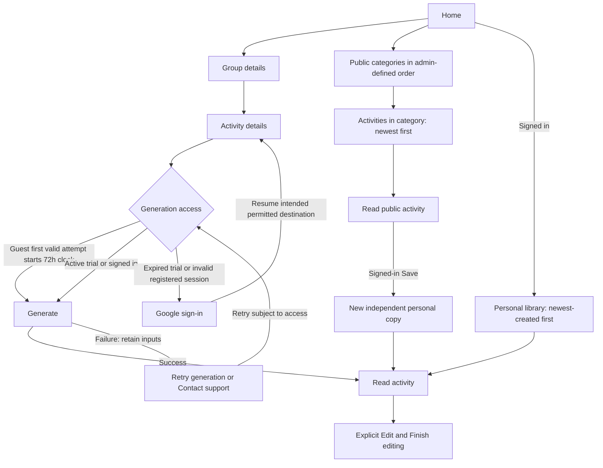

# Activity Wiz — User flows and screen behavior

Authoritative flows for [Product specification](product-spec.md), 12 October 2026. Read the product concepts first, then the overview below, then the detailed flows. English action names describe intent; interface copy is Hebrew and RTL. **Proposed** behavior is a reviewable implementation recommendation, not an additional approved feature.

## Overall journey

A counselor can prepare an activity with AI or browse ready-made public content. A signed-in counselor's generated activity is saved automatically. Saving public content creates a separate normal personal activity. Both lead to a readable detail screen, with explicit editing afterward.

Access checks also apply to public-library entry and direct links. Browsing or completing forms does not start the trial; submitting a valid generation attempt does. Trial expiry blocks new creation/library entry without erasing open work or interrupting an in-progress generation. Authentication distinguishes new-account registration from login to an existing account as defined in F02.

Every screen includes the global navigation bar. Bottom destinations are Home, Create and Public library, plus Personal library when signed in. A signed-in user's circular Google profile photo appears in that navigation. Avatar placement and any neutral guest/fallback appearance belong in the planned `design-system.md`; no second navigation bar or avatar menu is assumed.

## Screen and route contract

Only `/login`, `/admin` and `/admin/activity` are fixed paths. Other screen names below are identities, not prescribed URLs. Route shapes belong in the planned `architecture.md` and `api-contracts.md`. Editing/loading may be states of an existing route.

| Screen | Access and content | Main transition |
| --- | --- | --- |
| Home | All visitors; guest Google sign-in then Create, signed-in Create in that area | Group details, public library or own personal library |
| Login — `/login` | Google sign-in with pending/error feedback and intended destination | F02 account-specific transition |
| Group details | Guest before trial/within trial or signed-in; four group fields | Activity details; Back to Home |
| Activity details | Valid creation state; type/subject/place/duration plus collapsed optional section | Submit generation; Back to Group details |
| Generating | Valid authorized submitted request | Read result or input-preserving generation error |
| Current guest activity | Temporary generated text/name and activity details | Read/Edit; new registration can save it |
| Personal library | Valid signed-in user; own titles/dates and Delete | Own personal Read detail |
| Personal detail | Valid owner; available non-deleted activity | Read/Edit, autosave, confirmed Delete |
| Public library/category | Guest before trial/within trial or signed-in; numeric category order, then newest-first activities | Category or public detail |
| Public detail | Same access gate; name/text and normal activity details | Signed-in Save to new personal Read detail; Back to category |
| Admin overview — `/admin` | Authorized admin; categories and activities, two Create actions, category reorder, Delete | Admin creation forms or confirmed deletion |
| Admin activity creation — `/admin/activity` | Title, existing category, all activity-specific fields, editable pasted/typed text | Explicit publication |
| Admin category creation | Name, optional local JPG | Explicit creation and position assignment |
| Informational pages | All visitors; preserved text with new visual design | Global navigation |

## Shared states and error routing

| State | Behavior |
| --- | --- |
| Loading | Show work in progress, not an empty-result message. |
| Empty collection | Show a genuine empty state with usable navigation; no missing-data redirect is required for a valid empty collection. |
| Incomplete visible form | Stay on that form, identify required missing/invalid fields and preserve other entries. |
| Missing route/creation-flow prerequisite or requested record | Redirect Home with concise feedback. This includes absent activity/category data and broken direct-entry creation state; do not invent values. Invalid authentication instead requires `/login`. |
| Inaccessible personal record | Do not reveal another owner's content; return Home with appropriate feedback. |
| Load/network failure | Distinguish from empty or proven missing data, retain available state and allow retry/navigation. |
| Generation failure | Keep form values; offer Retry generation or Contact support; create no empty activity. |
| Mutation pending | Show progress, not completion. Proposed: suppress duplicate clicks while the same deliberate operation is pending. |
| Mutation failure | Show truthful failure/unconfirmed status; preserve available data and do not navigate to a fabricated result. |
| Invalid session | Require Google sign-in for protected continuation, not guest downgrade; F02 determines guest-draft handling only after successful account resolution. |

Every user-initiated Delete action uses a simple confirmation popup. Cancel leaves content untouched; Confirm applies the relevant deletion. The automatic discard of a guest draft after successful existing-account login is the F02 identity transition, not a Delete action. Errors do not bypass these rules.

## F01 — Enter Home and choose a path

Requirements: P01–P05, P22–P24.

1. Restore a valid registered session when available and show its circular Google photo and Personal navigation.
2. Otherwise, distinguish a genuine guest from a recognized registered account requiring login. Do not intentionally substitute a guest session for a failed registered session.
3. For a guest, read any existing trial start. Do not create a trial start merely because Home, the library or a form was opened. Show Google sign-in followed by Create.
4. Before the first generation attempt or during an active trial, allow Create and Public library. After expiry, these entries go through `/login`, retaining the intended destination.
5. Home and informational pages remain accessible. Cookie clearing/another device may limit account recognition; do not promise universal identity detection or a cross-device guest clock.

## F02 — Google sign-in and account-specific draft handling

Requirements: P02–P04, P11, P18.

**Entry:** voluntary login, expired-trial gate, invalid registered session or admin authorization failure. Retain intended destination and currently available inputs while authentication is pending.

1. Show Google as the sole provider, with progress/error feedback.
2. On cancellation, denial or authentication failure, keep available state. Do not erase a draft merely because a login attempt failed. An expired guest cannot dismiss the gate and resume protected guest use.
3. On successful **new-account registration**, save the one current open guest-generated activity, with its activity-specific details, latest name/text and new ownership. Do not copy group fields into the activity. Do not recover older guest sessions or save browsed public content automatically.
4. On successful **existing-account login**, discard the temporary guest activity draft. Do not save it into that account. Load that account's existing group defaults and personal collection; temporary guest group values must not overwrite account defaults automatically.
5. Return to the intended permitted destination. A newly transferred activity opens as personal Read detail. If existing-account login discarded the draft that was the intended destination, the required data no longer exists: return Home with appropriate feedback.

A registered user's unsaved edits to an owned personal activity are not a guest draft. Reauthentication must not use the guest-discard rule to erase those edits; authorization still depends on the resolved account owning the activity.

**Registration succeeds but transfer persistence fails:** do not claim the draft is saved. Proposed recovery: retain the authenticated session and available draft, show the error and retry persistence without regeneration or adding manual Save. Exact retry/idempotency mechanics belong in the planned `api-contracts.md`.

**Admin destination:** recheck verified-email authorization after Google login. An authenticated non-admin remains unauthorized and is redirected to `/login`; present an authorization explanation without an automatic login loop. Missing/invalid allowlist configuration grants no admin access.

## F03 — Provide group details

Requirements: P06–P08.

1. Show movement, participant grade, group amount and gender composition with the exact choices in Product specification §4.
2. Prefill the user's durable group set, or available temporary guest values. Proposed empty default: leave fields unselected when no values exist.
3. Require all four to Continue. Incomplete visible fields stay on the form with validation feedback.
4. Explicit registered changes update the user's one group set; guest changes remain temporary. Proposed persistence boundary: successful Continue, not each selection. A persistence failure retains choices and allows retry.
5. Continue passes the current group into Activity details for the upcoming request. It does not create group fields on an activity. Back returns Home with available in-progress entries preserved.

A movement change updates the available types. Proposed selection rule: retain the current type if valid for the new movement, otherwise use its first type. Do not submit an incompatible type. If the screen is entered without required underlying creation-flow/route state rather than merely unfilled visible fields, redirect Home under P26.

## F04 — Describe and generate

Requirements: P03, P06, P08–P10, P26.

1. Show type, subject, place and duration, then the initially collapsed optional section containing equipment, grouping/competition, Sabbath adaptation and notes. Restore available valid in-progress activity entries. Optional fields remain optional; collapsing the section does not delete entered values.
2. Back returns to Group details with available activity inputs retained. A missing underlying group context is a missing-data error and redirects Home; normal required-field validation stays on the form.
3. Generate validates the completed form. Validation failures do not initiate a request or start the trial.
4. Check authentication/trial eligibility. For the guest's first valid generation submission, record the trial start at that attempt before issuing the generation request. A subsequent provider failure still consumes elapsed trial time. For later attempts, read the same original start; never slide/reset it. If expired, require Google login before the new request.
5. Combine the current account/temporary guest group with current activity details for one generation request. Group values are request inputs only, not fields saved with the result.
6. Show Generating. On success, follow F05. On failure, keep the filled form and offer Retry generation or Contact support. Retry repeats the request with retained values unless edited and still respects the original trial expiry. Contact support opens the configured contact destination without discarding the retry inputs; it does not create an automatic support ticket.

Do not interrupt a request because its trial expires while running. Finish and retain/open the result, while still gating subsequent protected entry. Proposed pending-request safeguard: suppress accidental repeated submissions until the current operation resolves. Timeout/cancellation mechanics belong in the planned `ai-generation.md` and `api-contracts.md`.

## F05 — Read the generated result

Requirements: P09–P13.

For a registered user, automatically persist the activity-specific details, name/text and ownership/lifecycle information, and open Read detail. Keep even a successful result the user considers poor. Group fields are not persisted on the activity. For a guest, show the current temporary result in Read mode; subsequent authentication follows F02.

If generation succeeds but personal persistence fails, retain the result and distinguish the save failure from generation failure. Proposed recovery: retry persistence where feasible, including after required reauthentication, without replacing the text through another generation or adding manual Save. Do not claim a stored detail destination exists before persistence succeeds.

Read mode favors unobstructed Hebrew content and copying into WhatsApp. Edit explicitly enters F06 on the same screen. There is no separate manual Save action for generated personal results.

## F06 — Edit and autosave

Requirements: P12–P14.

1. Edit enables only title/body on the same detail screen, with bold, underline and lists.
2. Changed personal content becomes pending and is saved automatically every few seconds, not per character. Show saving, saved or error; an acknowledgement for older text does not mark newer unsent edits saved.
3. Finish editing returns to Read mode without hiding pending/error feedback or acting as a manual Save button.
4. Title changes update the personal row without changing creation date/order. Editing does not change the user's group defaults, public original or another copy.
5. Guest edits remain temporary. New registration saves the current edits; successful existing-account login discards that guest draft under F02.

**Proposed loss-avoidance mechanics for the planned `api-contracts.md` and `implementation-plan.md`:** try pending saves on an intentional in-app exit and retain available local text until acknowledged; show clear failure before discarding unsaved personal edits; preserve owned edits through required reauthentication; reject stale writes rather than silently overwrite newer content; never let delayed autosave resurrect a deleted record. Precise conflict/navigation UI remains to be designed. No browser-close recovery guarantee or manual Save button is implied.

A missing record redirects Home; a known network/save error is not treated as proof that the record is missing. Never submit a retained personal edit under a different account's ownership after login.

## F07 — Personal library and confirmed soft deletion

Requirements: P04, P14–P15, P26.

Load the signed-in user's non-deleted activities newest-created first. Row information is title and creation date, with Open/Delete actions. Distinguish loading, empty and failed loads. Open validates ownership and displays Read detail. Missing/deleted/inaccessible detail data returns Home without revealing private content.

Delete in either list or detail opens a simple confirmation popup identifying the activity. Cancel leaves it unchanged. Confirm performs soft deletion: immediately remove it from user views after the operation applies, retain the underlying record for operator analysis, and make stale detail access return Home. Do not ask for a reason or infer one.

Proposed successful detail-delete destination: Personal library. If deletion fails, show the failure; if optimistic hiding was used, restore the item when failure is known or reconcile uncertain status before declaring success. Pending autosave cannot restore deleted content.

## F08 — Browse public categories and activities

Requirements: P03, P16, P26.

1. Apply the guest/session gate to index, category and detail entry, including direct links. Before the first generation attempt, browsing does not start the trial.
2. Show categories by numeric position controlled by admins. A genuinely empty library shows an empty state; loading/network failure shows its own state.
3. Open a category and list its activities newest-first. There is no activity-reorder interaction, ranking list or per-activity counting.
4. Open a public activity to read its text/name and normal activity details. Back returns to its category; proposed fallback when no referring route exists is the available category.
5. If the requested category/activity no longer exists or required route data is missing, redirect Home with feedback. A valid empty category stays visible as empty.

Expiry does not erase already-open content; new protected entry requires login. Viewing content must not write like/view counters. Category browsing has no free-text search.

## F09 — Copy a public activity

Requirements: P04, P11, P17.

Guests have no public Save control. A signed-in user selects Save on an available public detail:

1. Verify the current user and source/category availability. Missing source data returns Home under P26; transient storage/network failure is handled separately.
2. Create a fresh owned personal activity containing the name/text and **all** activity-specific values: type, subject, place, duration, equipment, grouping/competition, Sabbath adaptation and notes. Preserve optional unselected values. Do not add movement, participant grade, group amount or gender composition.
3. Assign fresh personal identity and copy-creation time. Retain no source-public ID, FK, backlink, provenance relationship or synchronization. The public category remains a public browsing concept, not a personal membership constraint.
4. Only after successful persistence, open the new personal detail in Read mode. The user may then explicitly Edit.
5. Every subsequent deliberate Save makes another independent copy, even of identical content.

A copy-storage failure remains on the available public detail with an error and another attempt; do not claim saved. Invalid authentication requires F02; whether to resume a pending mutation automatically belongs in `api-contracts.md` (planned) and must not create unintended extra copies. Proposed race behavior: if public deletion commits first, copying fails cleanly; a copy committed first survives later public deletion. Retry handling must never deduplicate separate saves by source.

## F10 — Admin entry and public publication

Requirements: P18–P19, P26.

1. Check Google authentication and verified email against the configured JSON-array allowlist on every admin route and mutation. Local configuration is a string in `.env`; deployment uses a Cloudflare secret. Missing/invalid configuration denies access. Unauthorized users go to `/login` and writes change nothing.
2. Show the category overview in the same numeric order as the public library, with Create activity, Create category, reorder controls and Delete actions.
3. Create activity opens `/admin/activity`. Enter name/title, existing public category, activity type, subject, place, duration, equipment, grouping/competition, Sabbath adaptation, notes and manually typed/pasted text. Required activity fields and optional choices match Product specification §4; no movement/grade/group-amount/gender fields are entered. Type is distinct from category. The admin's own group defaults do not supply activity metadata.
4. Submit Add/Publish explicitly. Validate required fields in place and preserve entries on failure. With no category available, explain that a category must first be created; do not invent one.
5. Show publication pending; on success the activity appears first in its category. Proposed destination: its admin category listing. There is no AI call.

If the selected category is deleted before publication, preserve recoverable form values and redirect Home with missing-data feedback; do not publish an orphan activity. Authorization failure routes through `/login` and never retries a mutation solely because any Google account signed in. Creation does not add an edit-existing-public feature.

## F11 — Create and reorder categories

Requirements: P18–P20.

**Create:** enter a name, optionally select a JPG from the computer, then submit explicitly. Without an upload, use the shared default image. Missing visible name/invalid upload stays on the form with feedback and retained inputs. On success assign a numeric position; proposed initial placement is after existing categories. Proposed destination: admin category overview.

An upload/create failure must not appear successful or silently replace a failed chosen upload with the default image. The user can remove their selection intentionally. Upload limits/asset handling belong in the planned `architecture.md`, `design-system.md` and `api-contracts.md`.

**Reorder:** in the admin overview, change category order through the reorder control. Persist the numeric positions so both public and admin category lists reflect the same order. Reordering categories does not reorder activities inside them or move activities to a different category. Indicate pending/failure truthfully; a failed reorder must not be presented as saved. The exact gesture, position normalization and concurrent-reorder behavior are defined in the planned `design-system.md` and `api-contracts.md`.

## F12 — Confirm and hard-delete public content

Requirements: P18, P21.

An authorized admin selects Delete for an activity or category. Always show a simple confirmation popup. For category deletion, state that its public activities will also be deleted and personal copies will remain. Cancel makes no change. Confirm hard-deletes the selected activity, or the category and its public children.

Completed deletion removes the content from public/admin browsing and new-copy availability. Independently owned personal copies remain intact. Show pending/error feedback and do not declare a partial or rejected deletion complete. Technical atomicity belongs in the planned `data-model.md` and `api-contracts.md`.

Proposed post-success navigation: an activity deletion returns to its still-available admin category; a category deletion returns to the admin overview. Subsequent stale public links redirect Home under P26. Personal soft-delete behavior is unchanged.

## F13 — Informational pages and contact support

Requirements: P01, P23–P24, P26.

About, FAQ, Contact, Privacy and similar supplied pages remain accessible regardless of the guest clock. Give them the new product visual design and global navigation, preserving only the supplied text verbatim. Contact support from a generation error uses the configured contact destination and preserves available generation inputs for retry; no additional ticketing workflow is specified.

Keep configured advertising placements readable and retain Clarity for production activation. Required text, ad configuration and the support destination are release inputs; do not fabricate them. Any supplied text containing out-of-scope product links needs a focused editorial decision before publication.

## Acceptance matrix

| Check | Requirements / flows | Expected outcome |
| --- | --- | --- |
| A01 — Trial start | P03; F01/F04 | Site visits, browsing, form opening and invalid submissions do not start the clock. First valid generation attempt does, even if it fails; retries do not reset it. |
| A02 — Trial/session enforcement | P02–P03; F01/F02/F04 | Expired protected entry requires Google; running generation/open content survives; recognized session failure never silently becomes guest use. |
| A03 — Group boundary | P07–P09/P11; F03–F05 | One durable user group set, temporary guest group, exact options, current group used for the request but absent from saved activity fields. |
| A04 — Errors | P10/P26; F04/F05 | Missing underlying data returns Home; visible form validation stays; generation error keeps values and offers Retry or Contact support; no empty activity. |
| A05 — Authentication draft handling | P11; F02 | New registration saves current guest draft/details/edits; existing-account login discards it and loads account defaults; failed login does not discard it. |
| A06 — Edit/autosave | P12–P14; F06 | Explicit modes, title/body only, minimal formatting, truthful periodic autosave, no manual Save, immutable creation order. |
| A07 — Personal delete | P15; F07 | Both controls confirm; Cancel unchanged; Confirm soft-deletes and hides; stale detail returns Home; no reason prompt. |
| A08 — Category order | P16/P19; F08/F11 | Numeric positions control public/admin category order; admin reorder persists; activities stay newest-first and cannot be manually reordered. |
| A09 — Complete independent copies | P11/P17; F09 | All activity-specific values and text/name copied, no group fields/source relation; repeated saves produce distinct owned records; failed storage does not claim success. |
| A10 — Admin authorization | P18; F10–F12 | Multiple verified allowlisted Google emails supported; local JSON string/deployed secret; malformed/unset config fails closed; unauthorized writes rejected. |
| A11 — Public creation | P19–P20; F10/F11 | All normal activity-specific fields provided, manual text/no AI, separate category/type, optional JPG/default image, truthful validation/publication. |
| A12 — Public delete | P21; F12 | Confirmation required, Cancel unchanged, Confirm hard-deletes; category deletion includes public children and never personal copies. |
| A13 — Navigation and discovery | P05/P16; F01/F08 | Every screen has global navigation; signed-in circular Google photo; role-appropriate bottom destinations; category browsing without ranking or counters. |
| A14 — Information pages | P22–P24; F13 | New visual design/global navigation, supplied text unchanged, readable configured ads, Clarity retained. |
| A15 — Save recovery recommendations | P13; F06 | When finalized: retained personal edits remain owner-bound after reauthentication and delayed writes cannot resurrect deleted content. |

The planned `design-system.md`, `api-contracts.md` and `implementation-plan.md` will finalize the explicitly proposed gestures, destinations and low-level save/retry behavior. This does not reopen trial timing, account-only group data, guest-draft disposal, complete independent copying, numeric category order or mandatory confirmation and deletion semantics.
